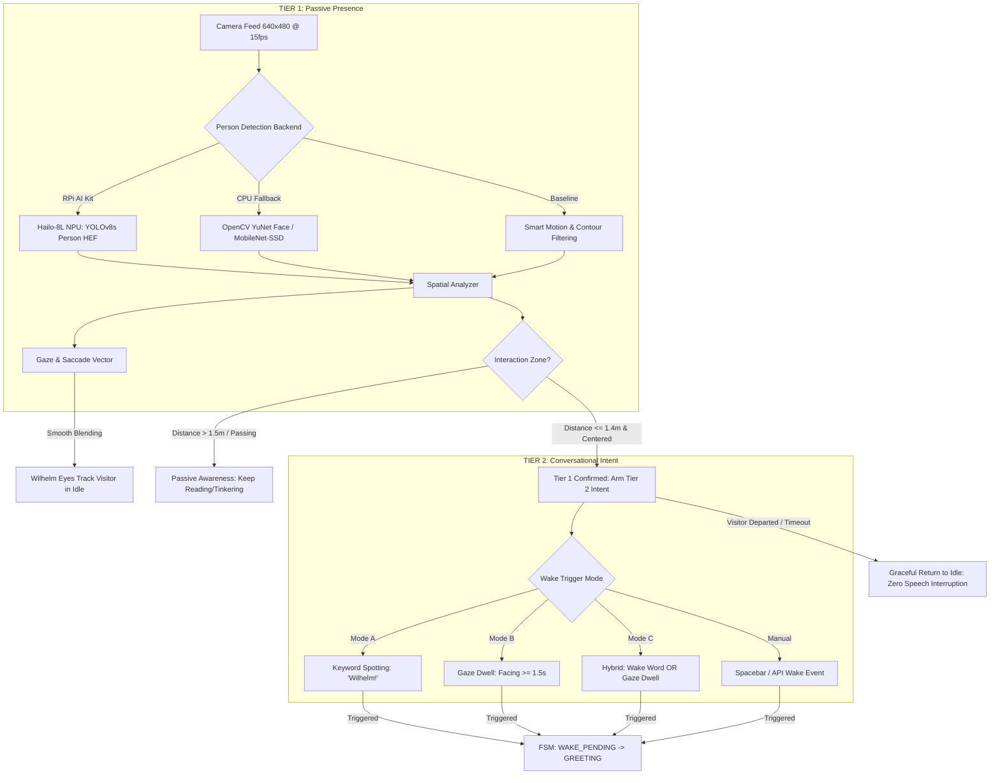
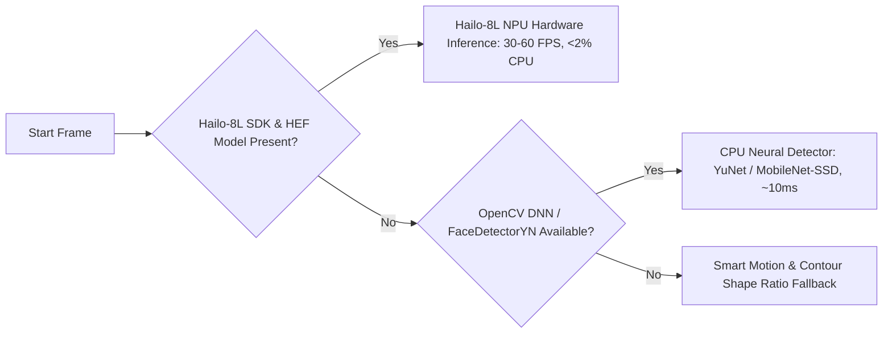
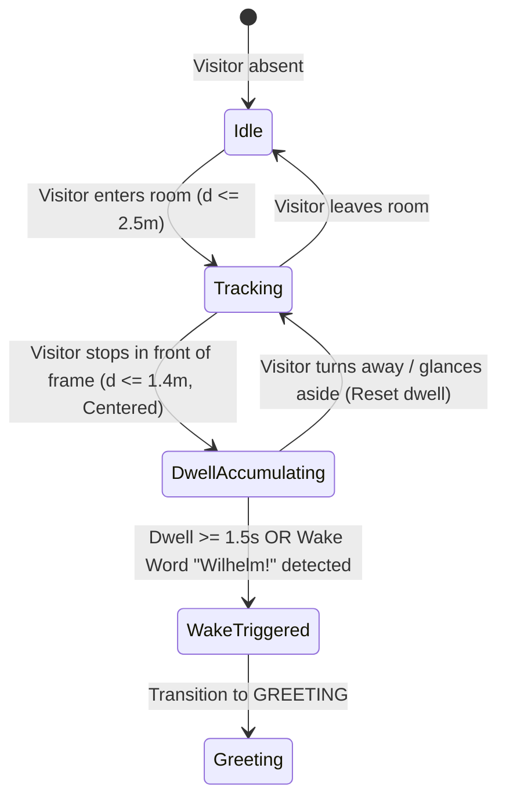
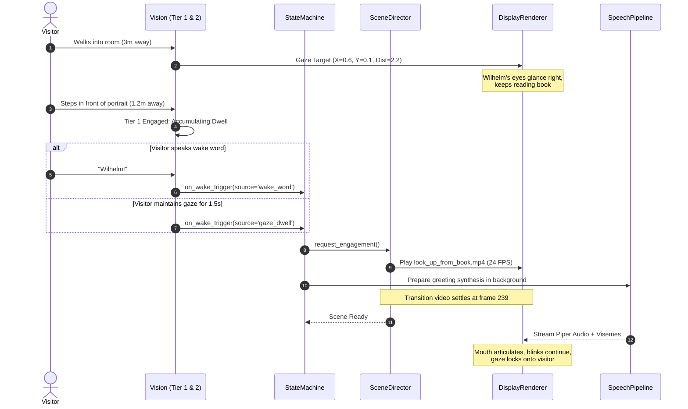

# Wilhelm: Smart Presence & Two-Tier Wake Word Architecture Plan

**Document Version:** 1.0  
**Target Platform:** Raspberry Pi 5 (Hailo-8L NPU / ARM Cortex-A76) & Cross-Platform Desktop  
**Date:** November 2026  
**Status:** Approved Architectural Proposal & Prototype Design  

---

## Executive Summary

The Harry Potter Talking Portrait (*Wilhelm, the Wandering Artificer*) is designed to create the illusion of a living, sentient being bound within an enchanted oil canvas. In folklore and cinema, portraits in the Hogwarts castle are perceptive: they notice when visitors approach, eye them warily or warmly, but do not interrupt their own activities unless spoken to or directly engaged.

### The Problem with Raw Camera Motion
Currently, Wilhelm relies exclusively on optical frame-differencing (`cv2.absdiff`) in [`vision/hailo.py`](file:///c:/Users/jonah/Documents/Atlas/HPPort/vision/hailo.py). Any environmental motion above a minimal contour area (1500 pixels) triggers `is_person_detected() == True`. In [`state_machine.py`](file:///c:/Users/jonah/Documents/Atlas/HPPort/state_machine.py), just 3 frames (0.3s) of motion transitions the portrait from `IDLE` to `WAKE_PENDING`, and a single subsequent frame (0.1s) immediately commands the portrait into `GREETING`.

This creates severe user-experience and immersion failures:
1. **False Wake Storms:** Ambient room lighting adjustments, shadows from outside windows, swaying curtains, or a house pet trigger full vocal greetings.
2. **Hallway Passersby:** A person walking past the portrait to reach another room causes Wilhelm to interrupt his reading or tinkering, play a 10-second transition video, and speak into an empty room.
3. **The Awkward Pacing Lock:** Because generative video transitions are 10.0 seconds (240 frames), waking prematurely locks Wilhelm into a long visual sequence before realizing no visitor is actually standing in front of him.
4. **Lack of Perceived Intelligence:** Wilhelm lacks *spatial awareness*—he cannot distinguish someone standing 18 inches away with intent to speak from someone 15 feet away glancing at a bookshelf.

### The Solution: Two-Tier Perception & Engagement Pipeline
To resolve these issues while respecting the compute boundaries of the Raspberry Pi 5, we propose a decoupled, **Two-Tier Perception Pipeline**:

- **Tier 1 (Passive Presence & Spatial Awareness):** Continuous, lightweight computer vision identifies whether a *human* is in the room and tracks their spatial position, distance, and gaze vector. While in Tier 1, Wilhelm is *aware*—his eyes follow the visitor with micro-saccades and gentle head tracking—but he remains immersed in his book or tinkering without vocal interruption.
- **Tier 2 (Active Conversational Intent):** Confirms intentional visitor engagement before triggering vocal greetings and video transitions. Intent is triggered either by **Wake Word Activation** (*"Wilhelm!"*, *"Hey Wilhelm"*) or by **Sustained Gaze Dwell** (the visitor stops in the close interaction zone and looks directly at Wilhelm for $\ge 1.5$ seconds).



---

## 1. System Comparison: Legacy vs. Two-Tier Flow

| Metric / Dimension | Current Legacy Implementation | Proposed Two-Tier Architecture |
| :--- | :--- | :--- |
| **Detection Mechanism** | Frame-difference motion contour area (`absdiff`). | Person detection (Hailo-8L YOLO / OpenCV DNN YuNet) + spatial metrics. |
| **Spatial Awareness** | None. Single moving box anywhere in frame wakes the portrait. | Interaction zone categorization: `near` ($<1.2$m), `conversational` ($1.2\text{--}1.8$m), `far` ($>1.8$m). |
| **Immersion in Idle** | Wilhelm ignores visitors until full wake, then immediately bursts into speech. | Wilhelm's eyes subtly follow visitors as they enter the room while he continues reading/tinkering. |
| **Wake Trigger** | 3 consecutive frames (0.3s) of motion anywhere in field of view. | Intent-verified: Wake Word (*"Wilhelm!"*) OR sustained interaction gaze dwell ($\ge 1.5$s). |
| **Passerby Behavior** | Triggers 10s `look_up` transition, speaks greeting to an empty room, waits through 2 silence timeouts (11s). | Notices movement, tracks gaze briefly, remains in reading/tinkering state. Zero audio interruption. |
| **False Positive Rate** | High (insects, shadows, pets, daylight variations). | Near zero (requires positive human classification + acoustic or sustained gaze confirmation). |
| **Night/Away Synergy** | Away room (`empty_room.png`) wakes on any motion in the dark. | Summoned cleanly: *"Wilhelm, are you there?"* initiates `walk_in` sequence. |
| **Hardware Overhead** | Negligible CPU (1 thread, downscaled motion). | $<2\%$ CPU on RPi 5 with Hailo-8L NPU; $\sim 8\text{--}12\%$ of 1 core on CPU fallback. |

---

## 2. Tier 1: Person Presence & Spatial Proximity Engine

Tier 1 runs continuously on a bounded background thread. It must identify human presence, compute distance and position, and output visitor gaze vectors to the display renderer without blocking Pygame rendering.

### 2.1 Backend Pipeline & Fallback Hierarchy

The system operates across three target environments using a runtime-detected fallback chain:



#### 1. Hardware Primary: Raspberry Pi AI Kit (Hailo-8L NPU)
- **Hardware:** 13 TOPS INT8 neural accelerator connected via PCIe 2.0 / 3.0 M.2 HAT+.
- **Model:** Pre-compiled Hailo Executable Format (`.hef`), specifically `yolov8s_person.hef` or `yolov8n_person.hef` (single-class person detector or COCO 80 with class-0 filter).
- **Performance:** 30–60 FPS at $640 \times 640$ or $640 \times 480$. Latency $<12$ms. CPU utilization $<2\%$.
- **Driver Integration:** Wrapped in [`vision/person_detector.py`](file:///c:/Users/jonah/Documents/Atlas/HPPort/vision/person_detector.py) using the `hailo_platform.pyhailort` PyHailoRT API.

#### 2. CPU Secondary: OpenCV DNN / YuNet
- **Model:** OpenCV 5.0 built-in `cv2.FaceDetectorYN` or quantized MobileNetV2-SSD (`.onnx` or `.pb`).
- **Performance:** On Raspberry Pi 5 ARM Cortex-A76, YuNet at $320 \times 240$ runs in $\sim 9\text{--}14$ms per frame on a single core.
- **Benefits:** Built directly into OpenCV without requiring external heavy runtimes like PyTorch or MediaPipe.
- **Thread Safety:** Enforces `cv2.setNumThreads(1)` to reserve 3 cores for Piper TTS, Faster-Whisper, and the Pygame renderer.

#### 3. Baseline Baseline: Smart Motion with Morphological Spatial Filtering
- Preserves the proven OpenCV background subtraction baseline for environments where neural weights are not yet downloaded.
- Enhances raw motion with **aspect ratio validation**: rejects horizontal motion bands (shadows, curtains) and accepts vertical silhouettes ($1.2 \le \text{height}/\text{width} \le 3.5$) matching human stature.

---

### 2.2 Spatial Distance & Interaction Zone Modeling

Rather than treating detection as a binary boolean, Tier 1 computes a continuous metric model of the visitor:

$$d_{\text{norm}} = \frac{h_{\text{ref}}}{h_{\text{bbox}}}$$

Where:
- $h_{\text{bbox}}$ is the normalized bounding box height ($0.0 \text{ to } 1.0$) relative to the frame.
- $h_{\text{ref}}$ is the calibrated reference height of an adult at standard conversational distance ($\approx 1.4$ meters, typically $0.45$ of frame height).

```
+-------------------------------------------------------------+
| Camera Frame                                                |
|                                                             |
|   +-----------------------+        Distance Estimation:    |
|   | Background Person     |        Normalized Dist: 2.4    |
|   | (h_bbox = 0.18)       |  ===>  Zone: PERIPHERAL/FAR    |
|   +-----------------------+        Action: Eye Gaze Only   |
|                                                             |
|           +-------------------------------+                 |
|           | Active Visitor                |                 |
|           | (h_bbox = 0.52)               |  ===>  Dist: 0.86     |
|           | Gaze X: +0.08, Y: -0.12       |        Zone: ENGAGED  |
|           +-------------------------------+        Action: Arm T2 |
|                                                             |
+-------------------------------------------------------------+
```

#### Interaction Zones

| Zone Name | Distance ($d_{\text{norm}}$) | Bounding Box Height ($h_{\text{bbox}}$) | Behavioral Response |
| :--- | :--- | :--- | :--- |
| **Absent** | $\infty$ | $0.0$ | Idle background behavior. Gaze centered at book/tools. |
| **Far / Peripheral** | $> 1.8$ ($> 2.5$m) | $< 0.25$ | Wilhelm notices presence: subtle micro-saccade toward doorway, but remains reading. |
| **Approaching** | $1.4\text{--}1.8$ ($1.8\text{--}2.5$m) | $0.25\text{--}0.35$ | Eye gaze tracks visitor smoothly ($18\%$ EMA smoothing). Prepares Tier 2 listeners. |
| **Conversational** | $0.6\text{--}1.4$ ($0.8\text{--}1.8$m) | $0.35\text{--}0.75$ | Arm Tier 2 wake triggers. Dwell timer begins accumulating. |
| **Immediate / Intimate**| $< 0.6$ ($< 0.8$m) | $> 0.75$ | Strong engagement cue; visitor is directly in front of the glass. |

---

## 3. Tier 2: Conversational Intent & Wake Word Triggering

Tier 2 resolves the core paradox of the living portrait: **How do we make Wilhelm responsive when approached, without him interrupting everyone who walks by?**

### 3.1 Modality A: Wake Word Activation (Keyword Spotting)
In magical lore, portraits often speak when addressed by name (*"Good morning, Sir Cadogan!"* or *"Wilhelm!"*).

#### Engine Options for Raspberry Pi 5
1. **openWakeWord (Open-Source Primary):**
   - Runs on ONNX Runtime on CPU or Hailo.
   - High precision, $<5\%$ CPU on 1 core of RPi 5.
   - Pretrained keyword models or acoustic phoneme detection for `"Wilhelm"`, `"Hey Wilhelm"`.
2. **Porcupine by Picovoice:**
   - Ultra-low latency ($<1\%$ CPU), industry standard for embedded keyword spotting.
   - Generates custom `.ppn` model for `"Wilhelm"`. Requires API key for model compilation.
3. **Prompt-Gated / Energy-Filtered Whisper (Immediate Zero-Binary Baseline):**
   - When Tier 1 detects a person in the Conversational Zone, the microphone opens a rolling 1.5-second VAD audio buffer.
   - If speech energy exceeds threshold, `faster-whisper` (`tiny.en` int8, already present in Wilhelm's STT stack) transcribes the initial phrase.
   - If the transcript matches configured wake phrases (`"wilhelm"`, `"hey wilhelm"`, `"hello"`, `"excuse me"`), Tier 2 fires.

---

### 3.2 Modality B: Intent-Based Gaze Dwell ("Look and Converse")
Voice wake words are great in private studies, but in exhibitions or living rooms, visitors often simply walk up to a painting and stare with curiosity. Forcing them to say a rigid wake word breaks the illusion.

**The "Look and Converse" Algorithm:**
1. Tier 1 confirms the visitor is in the **Conversational Zone** ($d_{\text{norm}} \le 1.4$).
2. Tier 1 confirms the visitor's face/body is **centered and facing the portrait**:
   $$|\text{gaze}_x| \le 0.40 \quad \text{and} \quad |\text{gaze}_y| \le 0.40$$
3. The visitor maintains this engaged posture continuously for the **Gaze Dwell Threshold** ($\tau_{\text{dwell}} = 1.5\text{ seconds}$).
4. Once $\tau_{\text{dwell}}$ is reached, Wilhelm interprets this as unmistakable human intent: he sets down his quill/tool, looks up, and initiates conversation!



---

### 3.3 Multi-Modal Hybrid Matrix

To give the operator full control, Wilhelm's configuration supports four wake modes:

```json
"vision": {
  "two_tier": {
    "enabled": true,
    "tier2_wake_mode": "hybrid",
    "wake_words": ["wilhelm", "hey wilhelm", "hello wilhelm"],
    "gaze_dwell_threshold_seconds": 1.5,
    "max_interaction_distance": 1.4,
    "min_person_bbox_height_ratio": 0.25,
    "facing_angle_tolerance": 0.40
  }
}
```

- `"hybrid"` **(Recommended Default):** EITHER the visitor says *"Wilhelm"* OR they stand and look directly at the portrait for 1.5s. Maximum immersion and natural feel.
- `"wake_word_only"`: Requires verbal address (*"Wilhelm"*). Ideal for noisy hallways where people linger without wanting to talk.
- `"gaze_dwell"`: Pure optical trigger. Ideal when microphone input is noisy or visitor speech is unpredictable.
- `"motion_legacy"`: Backward compatibility mode matching legacy behavior for rapid testing.

---

## 4. State Machine & Conversational Pacing Integration

### 4.1 Refined State Flow

The integration respects the fundamental boundary in [`AGENTS.md`](file:///c:/Users/jonah/Documents/Atlas/HPPort/AGENTS.md):
- **Physical Scene Director** ([`renderer/scene_director.py`](file:///c:/Users/jonah/Documents/Atlas/HPPort/renderer/scene_director.py)) strictly governs physical clips (`reading`, `tinkering`, `engaged_book`, `walk_away`, `empty_room`, `walk_in`).
- **State Machine** ([`state_machine.py`](file:///c:/Users/jonah/Documents/Atlas/HPPort/state_machine.py)) strictly governs conversational turns (`IDLE`, `WAKE_PENDING`, `GREETING`, `LISTENING`, `THINKING`, `SPEAKING`, `COOLDOWN`).



### 4.2 Graceful Disengagement during WAKE_PENDING
If a visitor steps up to the portrait, arms Tier 2, but immediately walks away before the wake word or dwell triggers:
- Tier 1 detects absence ($d_{\text{norm}} \to \infty$).
- Dwell counter clears instantly.
- The State Machine remains in `IDLE`.
- **Zero transition clips are queued; zero audio greetings are spoken.** Wilhelm never talks to an empty room!

---

## 5. Prototype Code Architecture in `vision/`

The prototype implementation introduces a modular, test-covered structure inside `vision/`:

```
vision/
├── __init__.py               # Exports BaseVisionDetector, HailoVision, MockVision, SmartPersonDetector, TwoTierWakeController
├── base.py                   # Extended BaseVisionDetector with Tier 1/2 query methods
├── person_detector.py        # Modular Tier 1 detector backends (Hailo, OpenCV YuNet, Smart Motion)
├── wake_word.py              # Tier 2 Wake Word, Gaze Dwell & Two-Tier Controller
├── hailo.py                  # Production camera capture integrating SmartPersonDetector with full backward compatibility
└── mock.py                   # Interactive mock simulating presence, dwell, and wake word triggers
```

### 5.1 Interface Contracts (`vision/base.py`)
Additions to `BaseVisionDetector` ensure clean contract inheritance:
- `is_person_present() -> bool`: Tier 1 presence flag.
- `is_visitor_engaged() -> bool`: Tier 1 proximity + interaction zone check.
- `get_visitor_proximity() -> float`: Normalized distance estimate ($1.0 \approx 1.4$m).
- `get_person_detections() -> List[Dict[str, Any]]`: Bounding box list with confidences and class names.
- `get_presence_metrics() -> Dict[str, Any]`: Aggregated telemetry (dwell time, gaze, distance, facing confidence).

### 5.2 Modular Person Detector (`vision/person_detector.py`)
Implements `DetectionResult` and `BasePersonDetectorBackend` with:
- `HailoPersonDetectorBackend`: Safe conditional import of `hailo_platform.pyhailort`. Gracefully reports `is_available() == False` if running on desktop or without HEF weights.
- `OpenCVPersonDetectorBackend`: High-speed CPU inference using `cv2.FaceDetectorYN` or quantized DNN models.
- `MotionPersonDetectorBackend`: Aspect-ratio-filtered motion contours for robust zero-dependency fallback.
- `SmartPersonDetector`: Orchestrates fallback selection, computes proximity zones, and applies EMA smoothing to gaze coordinates.

### 5.3 Two-Tier Wake Controller (`vision/wake_word.py`)
Implements:
- `GazeDwellTrigger`: Tracks continuous dwell duration in the conversational zone ($|\text{gaze}_x| \le 0.40, d_{\text{norm}} \le 1.4$).
- `BaseWakeWordBackend`: Abstract acoustic keyword detector.
- `KeywordFilterDetector`: Fast regex/phoneme matcher over rolling VAD audio chunks or STT transcripts.
- `TwoTierWakeController`: Coordinates Tier 1 person metrics with Tier 2 intent triggers according to configured `tier2_wake_mode`.

---

## 6. Resource & Compute Budgets (Raspberry Pi 5)

| Subsystem | Execution Target | Target Frame Rate / Frequency | CPU Load (RPi 5) | Memory Footprint |
| :--- | :--- | :--- | :--- | :--- |
| **Camera Capture** | Picamera2 CSI / OpenCV V4L2 | 15 FPS ($640 \times 480$) | $3\text{--}5\%$ of 1 core | $\approx 24$ MB (ring buffers) |
| **Tier 1 Hailo Inference**| Hailo-8L M.2 NPU | 15–30 FPS ($640 \times 640$) | $<2\%$ (PCIe DMA transfers) | $\approx 35$ MB (HEF weights) |
| **Tier 1 CPU Fallback** | OpenCV YuNet / Motion (Single Thread) | 10 FPS ($320 \times 240$) | $8\text{--}12\%$ of 1 core | $\approx 15$ MB |
| **Tier 2 Gaze Dwell** | Pure Arithmetic in Vision Thread | 15 Hz | $<0.1\%$ | $<1$ KB |
| **Tier 2 Wake Word (KWS)** | openWakeWord / Energy VAD | 16 kHz Audio Chunks (0.1s steps) | $4\text{--}7\%$ of 1 core | $\approx 40$ MB |
| **Pygame Display Loop** | Main Thread (DRM/KMS Fullscreen) | 30 FPS Lock | $15\text{--}20\%$ of 1 core | $\approx 80$ MB |
| **Piper TTS Synthesis** | Background Worker Thread | On-Demand (during turns) | $60\text{--}80\%$ of 2 cores (burst) | $\approx 90$ MB |
| **Total System Load** | Quad-Core ARM Cortex-A76 @ 2.4 GHz | Steady State in Idle | **$\approx 15\text{--}25\%$ total CPU** | **$\approx 320$ MB RAM** |

---

## 7. Implementation Roadmap & Verification

1. **Phase 1: Vision Module Architecture & Prototype Hooks (Completed in this Turn)**
   - Expand `vision/base.py` with two-tier interfaces.
   - Author `vision/person_detector.py` with Hailo, OpenCV, and Smart Motion backends.
   - Author `vision/wake_word.py` with Gaze Dwell trigger, Wake Word stubs, and Two-Tier Controller.
   - Upgrade `vision/hailo.py` and `vision/mock.py` to seamlessly integrate new hooks.
   - Implement unit test suite in `tests/test_two_tier_vision.py` verifying detection, dwell accumulation, and intent triggers.
2. **Phase 2: Hailo-8L Model Provisioning & Benchmarking**
   - Provide pre-compiled `yolov8s_person.hef` in `/mnt/portrait/models/hailo/`.
   - Validate PyHailoRT zero-copy DMA buffers on physical Raspberry Pi 5 hardware.
3. **Phase 3: State Machine & Speech Pipeline Binding**
   - Connect `TwoTierWakeController` outputs to `PortraitStateMachine.on_person_frame()` and `on_wake_trigger()`.
   - Route rolling VAD audio chunks to Tier 2 KWS when Tier 1 is in Conversational Zone.
4. **Phase 4: Sub-Attentive Glances in Scene Director**
   - Allow Wilhelm to perform subtle head tilts or eye tracking in `renderer/scene_director.py` when visitors dwell in the peripheral zone, without triggering state transitions.

---

*Authored by the Detector Agent for the Harry Potter Talking Portrait Swarm.*
