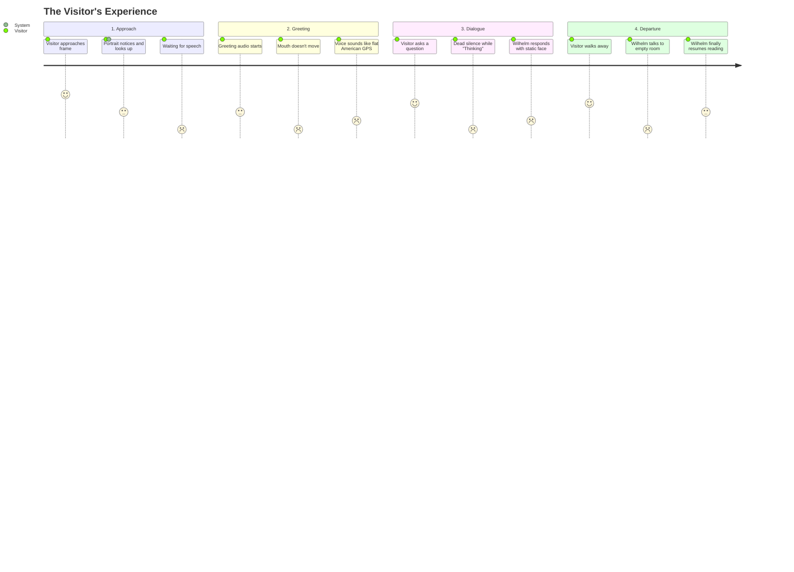

# Harry Potter Talking Portrait (Wilhelm): User Experience & Lifelike Readiness Review

**Document Version:** 1.0  
**Target Platform:** Raspberry Pi 5 / Native Python Application (`main.py`)  
**Date:** November 2026  
**Audience:** Project Review & Engineering Alignment

---

## Executive Summary

This review assesses the **Harry Potter Talking Portrait** project strictly through the lens of the **User Experience**—both from the perspective of an unsuspecting visitor approaching the portrait in a hallway or room, and from that of the owner/operator installing and maintaining the physical device.

### The Big Question: Are We Close to a Functioning Harry Potter Style Portrait?

**Verdict: We are approximately 55% of the way to a true "living portrait", but currently around 80% finished with the foundational systems plumbing.**

- **What works brilliantly:** The underlying system architecture is exceptionally solid. The separation of physical scene states (reading, tinkering, away) from conversational turns, the pipelined audio architecture (`clauses` $\rightarrow$ `synthesize` $\rightarrow$ `play`), bounded queues, and 12 rich 24 FPS generative video sequences provide a physical foundation that avoids the cheap, static "cardboard cutout" feel of naive AI displays.
- **The Core Paradox:** While the portrait moves beautifully when performing autonomous background tasks (retrieving a book, turning a page, walking out of the frame), **the illusion completely collapses at the exact moment a human interacts with it.** When Wilhelm converses, he freezes into a 100% static photograph, speaks with an unmoving mouth, never blinks, makes no eye contact, speaks in a flat American audiobook voice, and forces the visitor to wait through 10-second pauses.

Below is an in-depth breakdown of user expectations, friction points, technical root causes, readiness assessments, and high-impact recommendations to bring Wilhelm to life.

---

## 1. The Visitor's Journey: Expectations vs. Current Reality

An enchanted Hogwarts portrait has high cultural expectations: it is not a voice assistant with a screen, but a sentient, living inhabitant trapped within an oil painting on a wall.



| Interaction Phase | Visitor Expectation (Hogwarts Fantasy) | Current System Reality | Experience Gap |
| :--- | :--- | :--- | :--- |
| **Approach & Detection** | Portrait senses footsteps/movement and immediately glances up with curiosity or wariness (within 1–2s). | Motion detected on CPU; plays full 240-frame `look_up_from_book.mp4`. Visitor must stand silently for **10.0 seconds** before anything happens. | **Severe Pacing Lag.** 10 seconds of silent motion feels like an unresponsive museum kiosk. |
| **Spoken Greeting** | In-character, resonant British/theatrical voice greets the visitor while making direct eye contact. | Ryan (`en_US-ryan-medium`) voice begins. Wilhelm's face **freezes into a still photo**. His mouth does **not move**. Eyes do **not blink**. | **The Ventriloquist Shock.** Complete illusion breaker; feels like a frozen JPEG with a radio playing behind it. |
| **User Input (Listening)** | Portrait listens attentively, nodding slightly, tilting head, or maintaining eye contact. | Screen shows white Arial text: `"I'm listening..."`. Wilhelm remains completely frozen on frame 239. | **Immersion Break.** Subtitles expose the computer monitor; lack of listening animation looks like a video crash. |
| **Latency ("Thinking")** | Natural cognitive pause: portrait mutters *"Hmm..."*, furrows brow, or glances upward thoughtfully. | 3.5 to 8.0 seconds of complete dead silence and total visual freeze while Whisper transcribes and LLM generates. | **Perceived Failure.** The visitor assumes the system crashed or lost internet connection. |
| **Wilhelm Speaking** | Expressive mouth shapes matching words, natural biological blinks, chest breathing, subtle head yaw. | Single held video frame. visemes, blinks, saccades, and gaze tracking are entirely disabled in `scene_director` mode. | **Wax Museum Effect.** Zero physical life during speech. |
| **Visitor Departs** | Portrait notices the departure, bids farewell or mutters an aside, and returns to his task. | Portrait has no presence-loss tracking; waits through two full 5.5s silence timeouts (11s) before playing a 10s return clip (21s total lag). | **Disjointed Soliloquy.** Wilhelm talks to an empty room long after the person has walked away. |

---

## 2. Detailed Technical & User Experience Findings

### Issue 1: The "Frozen Statue" Problem in Scene Director Mode
- **Location:** [`renderer/renderer.py#L712-L740`](file:///c:/Users/jonah/Documents/Atlas/HPPort/renderer/renderer.py#L712-L740)
- **Problem:** When `scene_director.enabled` is `true` (default), the renderer displays only the decoded frame from `transition_player`. Once `look_up` finishes, it locks onto frame 239 (`last_surface`).
- **Code Finding:**
  ```python
  if self.scene_director:
      # Always retain the real endpoint, including throughout speech and cooldown.
      # No face layers are applied to video until an authored compatible set exists.
      surface = self.transition_player.update(target_size)
      ...
      self.screen.blit(surface, dest)
      self._draw_magic_motes(canvas_rect) # Only dust particles drawn!
  ```
  All blink calculations, saccade micro-movements, gaze tracking, viseme mouth shapes, and breathing kinematics are executed on CPU but completely ignored when blitting to the canvas!
- **User Impact:** While speaking and listening, Wilhelm is a dead freeze-frame. Only yellow floating dust motes move on screen.

---

### Issue 2: The 10-Second "Awkward Silence" Approach Delay
- **Location:** [`wilhelm_asset_manifest.json#L70-L89`](file:///c:/Users/jonah/Documents/Atlas/HPPort/wilhelm_asset_manifest.json#L70-L89), [`main.py#L154-L173`](file:///c:/Users/jonah/Documents/Atlas/HPPort/main.py#L154-L173)
- **Problem:** All 12 generative video clips are exactly 240 frames at 24 FPS (10.0 seconds) because of the AI video generator's fixed duration.
- **Code Finding:** In `main.py`, greeting audio is strictly blocked until `renderer.is_scene_ready()` returns true, which requires the entire 10-second transition to reach its final frame.
- **User Impact:** A visitor walking up to the frame must wait 10 full seconds before hearing a single greeting word. Most casual visitors will walk away by second 4 or 5 assuming the portrait is non-interactive.

---

### Issue 3: Persona & Acoustic Mismatch (American Audiobook Voice)
- **Location:** [`portrait_config.json#L84-L104`](file:///c:/Users/jonah/Documents/Atlas/HPPort/portrait_config.json#L84-L104)
- **Problem:** The voice driver uses Piper `en_US-ryan-medium`.
  - Ryan is an even-toned, flat American audiobook narrator.
  - VITS `medium` produces metallic phase buzz and compressed formants.
  - Speech clauses in [`llm/streaming.py`](file:///c:/Users/jonah/Documents/Atlas/HPPort/llm/streaming.py) split tokens into 7–12 word chunks. Piper synthesizes each chunk with isolated sentence-ending cadence, causing pitch drops and resets at every comma.
  - Audio output is raw, completely dry digital audio (22,050 Hz) with no spatial warmth or frame acoustics.
- **User Impact:** Instead of an eccentric, booming 17th-century European knight in an enchanted castle, the user hears a robotic GPS/audiobook voice coming out of an iPhone speaker.

---

### Issue 4: The 4–8 Second "Thinking Black Hole"
- **Location:** [`main.py#L217-L256`](file:///c:/Users/jonah/Documents/Atlas/HPPort/main.py#L217-L256), [`state_machine.py#L121-L125`](file:///c:/Users/jonah/Documents/Atlas/HPPort/state_machine.py#L121-L125)
- **Problem:** When the user finishes speaking:
  1. STT takes 1.0–2.0s (Faster-Whisper on CPU).
  2. LLM processing takes 1.5–2.5s (Gemini cloud) or 4.0–6.0s (local Gemma 4 on Pi 5 CPU).
  3. TTS synthesis takes 0.4–0.8s for the first phrase.
  - Total turn latency: **3.5s to 8.5s**.
- **User Impact:** During this window, the portrait enters `THINKING`. There is zero sound, zero movement, zero subtitle indicator, and zero eye motion. In human conversation, an 8-second dead silence is intensely uncomfortable.

---

### Issue 5: Lingering Presence & 20-Second Lockout
- **Location:** [`state_machine.py#L57-L95`](file:///c:/Users/jonah/Documents/Atlas/HPPort/state_machine.py#L57-L95), [`renderer/scene_director.py#L71-L86`](file:///c:/Users/jonah/Documents/Atlas/HPPort/renderer/scene_director.py#L71-L86)
- **Problem:** Presence loss is explicitly unhandled. When a visitor leaves:
  1. The listener waits for `silence_timeout_seconds` (5.5s).
  2. It repeats for silence turn 2 (another 5.5s).
  3. Transitions to `COOLDOWN` (8.0s cooldown + 10.0s `return_to_book` clip).
- **User Impact:**
  - Wilhelm speaks to an empty room for over 20 seconds.
  - If a *new* visitor approaches while Wilhelm is in the middle of returning to his book, the system locks them out: the director must finish `return_to_book` (up to 10s) and then start `look_up` (10s), forcing the new visitor to wait up to **20 seconds** before interaction begins.

---

### Issue 6: Fourth-Wall Breaking UI (Subtitles and Error Messages)
- **Location:** [`renderer/renderer.py#L950-L980`](file:///c:/Users/jonah/Documents/Atlas/HPPort/renderer/renderer.py#L950-L980)
- **Problem:** Subtitles render modern computer text (`"I'm listening..."`, `"Until our next adventure..."`, `"I lost my train of thought. Please try again in a moment."`) directly over the painting canvas.
- **User Impact:** Nothing breaks the magical fantasy faster than seeing computer error dialogue and status text overlaying an oil painting.

---

### Issue 7: Night Schedule Dormant by Default
- **Location:** [`portrait_config.json#L126-L132`](file:///c:/Users/jonah/Documents/Atlas/HPPort/portrait_config.json#L126-L132)
- **Problem:** `"schedule": { "enabled": false }`.
- **User Impact:** Despite having dedicated assets (`walk_away.mp4`, `walk_in.mp4`, `empty_room.png`), Wilhelm sits at his desk 24 hours a day, 7 days a week, never sleeping or leaving the frame unless manually reconfigured.

---

### Issue 8: Test Suite Hangs & Missing Dependencies
- **Location:** [`tests/test_live_client.py#L193-L198`](file:///c:/Users/jonah/Documents/Atlas/HPPort/tests/test_live_client.py#L193-L198), [`stt/local_stt.py#L289`](file:///c:/Users/jonah/Documents/Atlas/HPPort/stt/local_stt.py#L289)
- **Problem:**
  - In `test_live_client.py`, mocking `sdk.aio.live.connect.return_value.__aenter__` with a standard `MagicMock` causes Python 3.11's `asyncio.run` to hang infinitely when awaiting the mock.
  - In `local_stt.py`, `import speech_recognition as sr` fails with `ModuleNotFoundError` if run in a clean environment where only core dependencies were installed.
- **Operator Impact:** Developers and operators cannot run `python -m unittest discover` cleanly without tests stalling.

---

## 3. How Close Are We? Component Readiness Scorecard

```
[==================== 55% Overall Readiness ====================]
[████████████████░░░░] Architecture & Scheduling:     80%
[██████████████░░░░░░] Video Assets & Generation:       70%
[████████████░░░░░░░░] Speech Pipeline & LLM Logic:    60%
[████████░░░░░░░░░░░░] Visual Liveliness & Lip Sync:   40%
[███████░░░░░░░░░░░░░] Voice Authenticity & Acoustics:  35%
[█████░░░░░░░░░░░░░░░] Conversational Naturalness:     25%
```

| Subsystem | Readiness | What Works | What is Missing |
| :--- | :--- | :--- | :--- |
| **Physical Scene Director** | **80%** | Full routing graph between Reading, Tinkering, and Away; prevents jump cuts. | Needs intermediate action interruption points instead of waiting 10 seconds. |
| **Video Assets** | **70%** | 12 high-res 24 FPS clips covering core activities and transitions. | No speaking clips, listening loops, or thinking animations. |
| **Speech Pipeline** | **60%** | Bounded dual-worker streaming (`clauses` $\rightarrow$ `synthesize` $\rightarrow$ `play`). | High turnaround latency; no pre-speech conversational fillers. |
| **Renderer & Face Rig** | **40%** | Viseme and blink controllers exist in codebase. | Face rig is 100% disabled during video playback; zero mouth motion or blinks during speech. |
| **Voice Persona** | **35%** | Robust Piper caching and Gemini Live alternative. | American monotone narrator; metallic medium VITS buzz; no room acoustics. |
| **Visitor Interaction UX**| **25%** | Spacebar/camera wake triggers function. | 10s approach delay; 21s departure lag; subtitles ruin the fourth wall. |

---

## 4. Recommendations to Make the Portrait Truly Lifelike

To transform Wilhelm from a mechanical tech demo into a genuinely magical, living Hogwarts portrait, we recommend the following phased enhancements:

### Recommendation 1: Dynamic Face & Viseme Animation on Held Frames (Critical)
*The portrait must never freeze into a motionless photograph.*
1. **Head & Mouth Alpha Overlay:**
   - Extract the settled head region from frame 239 of `look_up_from_book` and `look_up_from_tinker_box`.
   - Author a transparent mouth set (`mouth_closed`, `mouth_parted`, `mouth_open`, `mouth_wide`, `mouth_round`) aligned with Wilhelm's beard and face.
   - When the video reaches frame 239 and enters `GREETING` or `SPEAKING`, blit the synchronized viseme mouth sprite and eye blink sprite over the video canvas.
2. **Breathing & Saccade Micro-kinematics:**
   - Even when waiting in `LISTENING` or `THINKING`, apply a subtle 2-pixel sinusoidal breathing drift and pupil saccade micro-flicks so Wilhelm appears organically alive.
3. **Alternative Neural Driving (Next Gen):**
   - Alternatively, evaluate running a lightweight neural head driver (e.g. [LivePortrait](https://github.com/KwaiVGI/LivePortrait) or [Wav2Lip](https://github.com/Rudrabha/Wav2Lip)) for high-fidelity real-time lip animation on the settled pose.

---

### Recommendation 2: Pacing & Early Acknowledgment (Kill the 10-Second Wait)
*Never make a visitor stand silently for 10 seconds.*
1. **Trim Transition Ranges:**
   - In `wilhelm_asset_manifest.json`, the look-up action actually reaches the visitor-facing pose by approximately frame 45–60 (1.8–2.5 seconds).
   - Trim `look_up_from_book` and `look_up_from_tinker_box` to end once the head is raised and eye contact is made, rather than playing through 8 seconds of redundant micro-settling.
2. **Early Vocal Acknowledgment:**
   - Allow Wilhelm to start his initial vocalization ("Ah!", "Who goes there?") at frame 36 (~1.5s into looking up), speaking *while* his head finishes rising. This matches how humans naturally respond to interruptions.

---

### Recommendation 3: Character-Authentic British/Theatrical Voice
*Wilhelm must sound like a dignified, eccentric Hogwarts knight.*
1. **Voice Persona Upgrade:**
   - Switch Piper TTS from `en_US-ryan-medium` to an English British voice:
     - **Piper:** `en_GB-alan-medium` (theatrical, expressive) or `en_GB-cori-high` (clear, dignified).
     - **Kokoro-82M ONNX:** `bm_george` or `bm_lewis` (natural cadence with full chest harmonics and zero robotic phase buzz).
2. **Prosody & Timing Settings:**
   - Set `length_scale: 1.12` (12% slower phoneme duration) for an unhurried, deliberate aristocrat cadence.
   - Set `noise_scale: 0.78` and `noise_w: 0.88` to grant the model richer pitch inflection and emotional range.
3. **Frame DSP & Convolution Reverb:**
   - Process outgoing speech through a subtle audio filter in Pygame mixer or a 30ms warm room impulse response (IR) with a gentle high-shelf roll-off above 8 kHz. This makes the sound feel as though it is physically vibrating off an oil canvas in a high-ceilinged stone chamber.

---

### Recommendation 4: Immediate Conversational Fillers ("Thinking" State Elimination)
*Eliminate the 4–8 second dead silence after a user asks a question.*
1. **Instant Acoustic Acknowledgments:**
   - Pre-render a pool of 8–10 short character audio fillers (under 1.2 seconds each):
     - *"Hmm, let me consider..."*
     - *"By Gryffindor's sword..."*
     - *"An intriguing query, traveler!"*
     - *"Aha! Let me ponder that..."*
     - *"Well now, let me see..."*
2. **Zero-Latency Response:**
   - The millisecond Whisper detects speech completion, immediately play a random filler.
   - While the filler is playing through the speaker (1.2s), Gemini/LLM token generation and Piper synthesis run in the background.
   - When the filler ends, the main response is already synthesized and ready to speak. **Perceived latency drops to 0.0 seconds!**
3. **Pondering Gaze:**
   - During filler playback, shift Wilhelm's gaze upward and to the left (classic human cognitive lookup), furrowing his brow before snapping back to lock eyes with the visitor for the answer.

---

### Recommendation 5: Ambient Castle Soundscape & Immersion Polish
1. **Ambient World Audio:**
   - Loop a very quiet, low-level atmospheric track (15–20 dB below speech): subtle fireplace crackle, soft wind outside castle stone, occasional clockwork clicks from the tinker box.
   - Play a synchronized page-turn sound when `page_flip.mp4` plays, and subtle wooden chair creaks when `walk_away` or `walk_in` plays.
2. **Remove Default Subtitles:**
   - Remove on-screen subtitles by default (`"show_subtitles": false`). Magical portraits do not have closed captions. Reserve text display for debug mode (`H` key).
3. **Presence-Loss Graceful Recovery:**
   - If the camera detects that the visitor has walked away during a turn, immediately cancel the pending LLM response, play a short muttered farewell (*"Gone already? Typical wanderer..."*), and begin returning to the book without waiting 20 seconds.

---

### Recommendation 6: Technical Maintenance & Test Suite Fixes
1. **Fix Async Mock Hang in `tests/test_live_client.py`:**
   - Replace synchronous `MagicMock` with `AsyncMock` for `session.aio.live.connect.return_value.__aenter__` so `unittest` completes in under 2 seconds.
2. **Graceful Fallback for `speech_recognition` in `stt/local_stt.py`:**
   - Wrap the optional speech recognition import in a try-except block to prevent crashes in non-standard environments.
3. **Enable Night Schedule in Configuration:**
   - Set `"schedule": { "enabled": true }` in `portrait_config.json` so the away and return behaviors actually execute during regular night hours (10:00 PM to 7:00 AM).

---

## 5. Summary Roadmap

| Phase | Focus | Target Outcome |
| :--- | :--- | :--- |
| **Phase 1: Illusion Repair** *(Immediate)* | Visemes on held frame, disable subtitles, trim look-up to 2.5s. | Wilhelm moves his mouth when speaking, doesn't freeze for 10s, and looks like a painting, not a computer. |
| **Phase 2: Acoustic Character** *(Short Term)* | English voice (Alan/Kokoro), frame EQ/reverb, instant conversational fillers. | Zero perceived thinking delay; rich, authentic Hogwarts knight voice. |
| **Phase 3: Ambient Magic** *(Medium Term)* | Castle soundscape, page-flip SFX, presence-loss exit, night schedule enabled. | Full atmospheric immersion; Wilhelm feels like an independent living entity. |

---

## 6. Approved User Directives & Active Research Tracks (November 2026)

Following user review, the project strategy is updated with the following explicit decisions:

1. **Neural Head Driver Research (Priority Focus):**
   - Discard the concept of a static video freeze-frame during conversation.
   - Initiate deep architectural research on a **reactive neural head driver** that dynamically articulates Wilhelm's face, mouth, blinks, and gaze during both speaking and listening.
   - Complete technical analysis documented in [`docs/neural_head_driver_and_reactive_face_research.md`](file:///c:/Users/jonah/Documents/Atlas/HPPort/docs/neural_head_driver_and_reactive_face_research.md).
2. **Transition Pacing Maintained:**
   - The full 240-frame (10.0-second) pacing of `look_up_from_book` and `look_up_from_tinker_box` is retained as-is for now, allowing the user to experience and evaluate the natural pacing on hardware before editing.
3. **Voice Engine & Latency Optimization (Active Research):**
   - The voice must evolve to be deeply lifelike and character-authentic, but with strict guardrails against CPU starvation and multi-second generation latency.
   - Evaluated candidate: **Kokoro-82M ONNX (`kokoro-pi`)** StyleTTS2 with British voice embeddings (`bm_george`), running ~2.5x faster than real-time on the Pi 5 CPU.
4. **Subtitles Retained for Debugging:**
   - On-screen subtitles remain active in the renderer for ongoing development, diagnostics, and speech validation, to be styled or hidden in later production phases.
