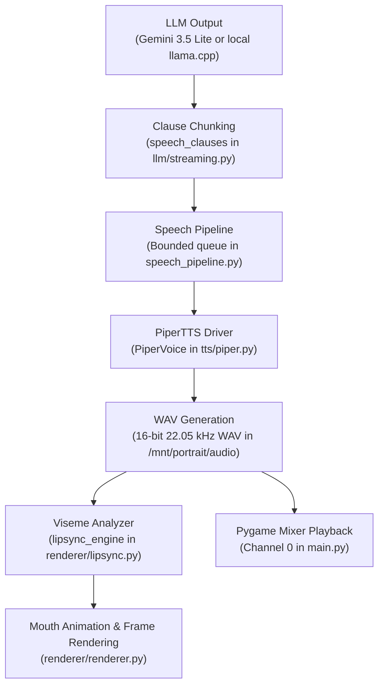

# Voice Investigation & Improvement Recommendations

This document details how voice synthesis and playback are currently performed in the **Harry Potter Talking Portrait (Wilhelm)** codebase, analyzes why the voice currently sounds robotic, fake, and slightly too fast, and provides comprehensive, researched recommendations to achieve a warm, natural, and character-authentic voice for an enchanted portrait.

---

## 1. Executive Summary

| Dimension | Current State | Root Problem | Target State |
| :--- | :--- | :--- | :--- |
| **TTS Engine** | [Piper TTS](https://github.com/rhasspy/piper) (VITS ONNX) | VITS `medium` architecture has metallic buzz and rigid formants | Upgraded Piper `high` voice, [Kokoro-82M](https://github.com/thewh1teagle/kokoro-onnx), or Gemini Live native audio |
| **Voice Persona** | `en_US-ryan-medium` | Modern American monotone narrator; mismatched with a Hogwarts knight/guardian | British English (`en_GB`) theatrical/dignified character (`alan`, `cori`, `bm_george`, or `Charon`) |
| **Speech Speed** | `length_scale: 1.0` (~170 WPM) | Phoneme durations are rushed; sounds machine-gunned without breathing pauses | `length_scale: 1.10 - 1.15` (10–15% slower phoneme duration; deliberate, stately pacing) |
| **Acoustic Jitter** | `noise_scale: 0.667`, `noise_w: 0.8` | Conservative defaults produce flat, metronomic pitch contours and rhythm | `noise_scale: 0.75 - 0.80`, `noise_w: 0.85 - 0.90` (more vocal inflection and rhythmic variance) |
| **Pipelining / Prosody** | Clause chunking at 7–12 words & commas in [`speech_clauses`](file:///c:/Users/jonah/Documents/Atlas/HPPort/llm/streaming.py#L11-L49) | Each clause is synthesized in isolation; pitch drops and resets on each chunk | Punctuation-anchored sentence synthesis or prosody carry-over |
| **Room Acoustics** | Completely dry 22,050 Hz playback | Raw digital audio exposes high-frequency quantization hiss and lack of body | Subtle portrait frame DSP: gentle warmth EQ and light room convolution reverb |

---

## 2. Investigation: How Voice is Performed in the Code

Speech in this repository traverses five distinct subsystems: **Text Generation**, **Streaming Clause Chunking**, **Neural Synthesis**, **Mixer Playback**, and **Viseme Analysis**.



### 2.1 Configuration Layer
Configured in [`portrait_config.json`](file:///c:/Users/jonah/Documents/Atlas/HPPort/portrait_config.json#L84-L104) and defaulted in [`config.py`](file:///c:/Users/jonah/Documents/Atlas/HPPort/config.py#L96-L116):

```json
"tts": {
  "driver": "piper",
  "piper_binary_path": "/mnt/portrait/models/piper/piper",
  "model_path": "/mnt/portrait/models/piper/en_US-ryan-medium.onnx",
  "model_config_path": "/mnt/portrait/models/piper/en_US-ryan-medium.onnx.json",
  "speaker_id": 0,
  "length_scale": 1.0,
  "noise_scale": 0.667,
  "noise_w": 0.8,
  "cache_enabled": true,
  "cache_dir": "/mnt/portrait/cache/tts",
  "audio_driver": "auto",
  "playback_sample_rate": 22050,
  "playback_channels": 1,
  "playback_buffer_size": 512,
  "runtime": "auto",
  "warmup_enabled": true,
  "synthesis_timeout_seconds": 30.0,
  "cache_max_entries": 128,
  "allow_synthetic_fallback": false
}
```

### 2.2 Text Generation & Clause Chunking
In [`llm/streaming.py`](file:///c:/Users/jonah/Documents/Atlas/HPPort/llm/streaming.py#L11-L46), `speech_clauses()` accepts streaming tokens from either Gemini or the local Gemma 4 model and splits them into speech chunks:
- Regular expression boundaries: `[.!?]+["”’)]*(?=\s)|\n|[,;:](?=\s)`
- Word limits: Initial chunks are limited to **7 words** (`word_limit = min(7, max(1, max_words))`) to minimize time-to-first-audio (TTFA), expanding to **12 words** for subsequent clauses.
- If a sentence has a comma early on (`len(...) >= 3`), or exceeds 7 words without punctuation, it is sliced and yielded immediately.

### 2.3 Synthesis Driver: `PiperTTS`
Implemented in [`tts/piper.py`](file:///c:/Users/jonah/Documents/Atlas/HPPort/tts/piper.py#L15-L224):
- **Runtime Mode (`runtime: "auto"`)**: Attempts to load the in-process Python runtime via `piper.PiperVoice.load(model_path)` with `SynthesisConfig(speaker_id=0, length_scale=1.0, noise_scale=0.667, noise_w_scale=0.8)`. This keeps the ONNX weights in RAM to eliminate per-turn process spawn latency.
- **CLI Fallback**: If `piper-tts` is not installed as a Python package, it invokes the standalone Piper binary via `subprocess.Popen` with CLI flags `--length_scale 1.0 --noise_scale 0.667 --noise_w 0.8`.
- **Disk Cache**: Hashes model identity, voice parameters, and text into a 64-character SHA-256 key stored in `/mnt/portrait/cache/tts`.
- **Output**: Generates a standard single-channel 16-bit PCM WAV at 22,050 Hz.

### 2.4 Orchestration & Playback
- **Bounded Pipeline**: [`speech_pipeline.py`](file:///c:/Users/jonah/Documents/Atlas/HPPort/speech_pipeline.py#L19-L109) coordinates two background worker threads (`portrait-generate` and `portrait-synthesize`). While chunk $N$ is being played through the speaker, chunk $N+1$ is being synthesized in the background.
- **Mixer Setup**: In [`renderer/renderer.py`](file:///c:/Users/jonah/Documents/Atlas/HPPort/renderer/renderer.py#L43-L57), Pygame mixer is initialized with:
  ```python
  pygame.mixer.pre_init(frequency=22050, size=-16, channels=1, buffer=512)
  pygame.mixer.init()
  ```
- **Playback Loop**: In [`main.py`](file:///c:/Users/jonah/Documents/Atlas/HPPort/main.py#L316-L342), `_play_prepared()` loads the WAV into a `pygame.mixer.Sound` object and plays it on Channel 0 while synchronizing mouth visemes with [`lipsync_engine.analyze_wav`](file:///c:/Users/jonah/Documents/Atlas/HPPort/renderer/lipsync.py).

### 2.5 Alternative Dormant Cloud Path: Gemini Live Native Voice
In [`live/gemini_live.py`](file:///c:/Users/jonah/Documents/Atlas/HPPort/live/gemini_live.py#L202-L248) and [`config.py`](file:///c:/Users/jonah/Documents/Atlas/HPPort/config.py#L23-L24):
- The codebase already includes an alternative direct audio route: setting `gemini_live.response_voice: "native"` bypasses Piper entirely and streams 24,000 Hz PCM audio directly from the Gemini Live API (`gemini-3.1-flash-live-preview`) using the studio voice **"Charon"**.
- Currently, `response_voice` defaults to `"piper"`, meaning even cloud LLM responses are rendered through the local Piper voice for acoustic uniformity.

---

## 3. Root Cause Analysis: Why Does It Sound Robotic, Fake, and Fast?

### Cause 1: Model Quality Tier (`medium` vs `high`)
Piper voice models are based on the **VITS** (Variational Inference with adversarial learning for end-to-end Text-to-Speech) architecture. VITS models are released in three tiers:
- **`low`**: 16 kHz sample rate, 64 hidden dimensions. Very robotic and raspy.
- **`medium`** (currently installed: `en_US-ryan-medium`): 22.05 kHz sample rate, 192 hidden dimensions. Designed for lightweight edge devices. While fast, the reduced parameter count causes formants to sound compressed, sibilant sounds to clip, and sustained vowels to exhibit a characteristic metallic buzz or phase cancellation.
- **`high`**: 22.05 kHz or 24 kHz, 512 hidden dimensions, trained with deeper residual networks. Produces noticeably smoother vocoder reconstruction, full chest harmonics, and cleaner high-frequency details.

### Cause 2: Persona Mismatch (American Audiobook Narrator vs. Enchanted Portrait)
The current model is **Ryan** (`en_US-ryan`). Ryan is a flat, even-toned, standard American audiobook narrator.
The persona of Wilhelm is:
> *"a bold eccentric forest guardian and noble warrior in an enchanted portrait"* ([`config.py` line 68](file:///c:/Users/jonah/Documents/Atlas/HPPort/config.py#L68))
Having an American audiobook voice recite medieval, chivalric dialogue (*"Halt, noble wanderer!"*) sounds jarringly synthetic and emotionally disconnected. The flat vocal tract resonances reinforce the sensation of an automated phone system rather than an enchanted being.

### Cause 3: Speech Rate Parameter (`length_scale = 1.0` is Too Fast)
In Piper TTS, `length_scale` controls the speed of speech by directly multiplying the duration of each phoneme predicted by the duration predictor network:
$$\text{Phoneme Duration} = \text{Predicted Duration} \times \text{length\_scale}$$
- `length_scale = 1.0` represents 100% of the training speaker's raw pace. For the Ryan dataset, this is roughly 160–180 words per minute.
- In normal conversation, humans insert micro-breaths, pauses for emphasis, and elongated vowels on stressed words. In synthetic TTS, running at `1.0` delivers steady, unrelenting phonemes without conversational pauses, which the human ear interprets as "too fast" and "machine-like".
- Setting `length_scale` to **`1.10 - 1.15`** increases phoneme length by 10–15%, slowing the speech to a calm, authoritative, theatrical pace.

### Cause 4: Acoustic Jitter Settings (`noise_scale` & `noise_w`)
VITS uses two stochastic noise parameters during synthesis:
- **`noise_scale` (currently `0.667`)**: Controls the variability of the latent generator (pitch contour and formant variation). When set too low, the voice locks into a robotic monotone.
- **`noise_w` (currently `0.8`)**: Controls the variability of phoneme durations. When set too low, every syllable of equal grammatical weight receives identical duration, destroying natural human cadence.
- Setting `noise_scale: 0.75 - 0.8` and `noise_w: 0.85 - 0.9` injects subtle human-like variations in pitch and timing.

### Cause 5: Prosody Fragmentation from Pipelined Clause Slicing
In [`llm/streaming.py`](file:///c:/Users/jonah/Documents/Atlas/HPPort/llm/streaming.py#L28-L43), text is sliced aggressively into chunks of 7 to 12 words to keep turnaround latency low:
1. Piper is invoked on each isolated clause (e.g. Chunk 1: `"Ah, a visitor arrives before my frame!"`, Chunk 2: `"State your business, noble wanderer!"`).
2. Neural TTS models compute pitch contours across the context of an entire sentence. When given a fragment, the model generates a sentence-final falling tone or abrupt pause, followed by a sentence-initial rising tone on the next chunk.
3. When Pygame plays these back-to-back, the listener hears unnatural pitch resets and awkward micro-pauses at every clause boundary, breaking melodic flow and sounding robotic.
4. If a chunk hits the 7-word limit without punctuation, Piper receives a phrase with no terminating punctuation, yielding an unnatural cliffhanger pitch.

### Cause 6: Completely Dry Audio Playback
The synthesized WAV is output dry into Pygame mixer:
- A real enchanted portrait is a physical painting hanging in a stone castle hall or wooden frame.
- Dry digital audio directly from a 22.05 kHz neural vocoder sounds sterile and clinical. The absence of acoustic room reflections emphasizes every digital vocoder artifact.

---

## 4. Research & Improvement Recommendations

We divide the recommendations into four tiers: from instant configuration-only adjustments to state-of-the-art local engines and cloud audio.

---

### Tier 1: Immediate Configuration-Only Improvements (Zero Code Changes)

You can dramatically improve the voice immediately without altering any Python code, simply by adjusting [`portrait_config.json`](file:///c:/Users/jonah/Documents/Atlas/HPPort/portrait_config.json).

#### Step 1: Tune Speech Rate and Variability
Adjust `length_scale`, `noise_scale`, and `noise_w` in the `tts` block of `portrait_config.json`:

```json
"tts": {
  "driver": "piper",
  "length_scale": 1.12,
  "noise_scale": 0.75,
  "noise_w": 0.85,
  ...
}
```
*Why this works:*
- `length_scale: 1.12`: Slows down speech delivery by 12%. Words become clearer, dignified, and comfortably paced.
- `noise_scale: 0.75`: Adds warmth and intonation dynamics, reducing robotic flatline pitch.
- `noise_w: 0.85`: Adds natural human rhythm variance across syllables.

#### Step 2: Switch to a High-Quality or British English Piper Voice
Piper offers several voices that fit Wilhelm far better than `en_US-ryan-medium`:

| Voice Name | Quality | Accent / Persona | Character Fit for Wilhelm | Download Size |
| :--- | :--- | :--- | :--- | :--- |
| **`en_GB-alan-medium`** | Medium (22 kHz) | British English male; mature, distinguished, clear | **Excellent**: Sounds like a dignified Hogwarts portrait | ~60 MB |
| **`en_GB-southern_english_male-medium`** | Medium (22 kHz) | Southern English male; warm, theatrical, articulate | **Very High**: Energetic and expressive | ~60 MB |
| **`en_GB-cori-high`** | High (22 kHz) | British English; crisp, studio grade, dynamic | **High**: Excellent clarity and zero buzz | ~110 MB |
| **`en_US-ryan-high`** | High (22 kHz) | American male; much cleaner than medium | **Moderate**: Retains current voice identity but removes robotic distortion | ~110 MB |

#### Download Instructions for Raspberry Pi (`/mnt/portrait/models/piper`):
```bash
cd /mnt/portrait/models/piper

# Recommended: Alan (Dignified British Portrait)
wget https://huggingface.co/rhasspy/piper-voices/resolve/main/en/en_GB/alan/medium/en_GB-alan-medium.onnx
wget https://huggingface.co/rhasspy/piper-voices/resolve/main/en/en_GB/alan/medium/en_GB-alan-medium.onnx.json

# Alternative: Ryan High (If you wish to keep Ryan's exact voice but remove the robotic buzz)
wget https://huggingface.co/rhasspy/piper-voices/resolve/main/en/en_US/ryan/high/en_US-ryan-high.onnx
wget https://huggingface.co/rhasspy/piper-voices/resolve/main/en/en_US/ryan/high/en_US-ryan-high.onnx.json
```

Then update `portrait_config.json`:
```json
"tts": {
  "model_path": "/mnt/portrait/models/piper/en_GB-alan-medium.onnx",
  "model_config_path": "/mnt/portrait/models/piper/en_GB-alan-medium.onnx.json",
  "length_scale": 1.12,
  "noise_scale": 0.75,
  "noise_w": 0.85
}
```

---

### Tier 2: Next-Generation Local Neural TTS: Kokoro-82M on Raspberry Pi 5

For the highest possible local voice quality on the Raspberry Pi 5 without cloud dependency, upgrade from Piper to **Kokoro-82M** via `kokoro-onnx`.

#### What is Kokoro-82M?
- **Architecture**: A compact 82-million parameter diffusion-based neural TTS model (derived from StyleTTS2) released under Apache 2.0.
- **Naturalness**: Rated on community benchmarks higher than older multi-gigabyte models. It features natural human breathing, authentic vocal fry, expressive pitch curves, and zero metallic vocoder buzz.
- **Raspberry Pi 5 Performance**:
  - The quantized `kokoro-v1.0.int8.onnx` is only **84 MB**.
  - On the Pi 5's Cortex-A76 quad-core CPU, `kokoro-onnx` runs with a **Real-Time Factor (RTF) of ~0.35 to 0.55** (1 second of speech is generated in ~0.4 seconds).
  - Output is studio-grade **24,000 Hz**.
- **Character Voices for Wilhelm**:
  - `bm_george`: Distinguished, cultured British gentleman (ideal for an eccentric Hogwarts knight).
  - `bm_fable`: Theatrical, expressive British narrator.
  - `bm_lewis`: Articulate, resonant British male.

#### Integration Architecture (Future Implementation Blueprint)
A Kokoro driver would inherit from [`BaseTTS`](file:///c:/Users/jonah/Documents/Atlas/HPPort/tts/base.py):
```python
from kokoro_onnx import Kokoro
import soundfile as sf
from tts.base import BaseTTS

class KokoroTTS(BaseTTS):
    def __init__(self, config):
        self.kokoro = Kokoro("models/kokoro-v1.0.int8.onnx", "models/voices-v1.0.bin")
        self.voice = config["tts"].get("voice", "bm_george")
        self.speed = float(config["tts"].get("speed", 0.92))  # 0.92 = slightly relaxed speed

    def synthesize_to_file(self, text: str, output_wav_path: str):
        samples, sample_rate = self.kokoro.create(text, voice=self.voice, speed=self.speed, lang="en-gb")
        sf.write(output_wav_path, samples, sample_rate)
        duration = len(samples) / float(sample_rate)
        return output_wav_path, duration
```

---

### Tier 3: Cloud Streaming Options (When Online)

If the portrait is connected to the internet, cloud options provide human-actor voice performance with zero local CPU load.

#### Option A: Activate Existing Gemini Live Native Voice ("Charon")
The codebase already contains full support for Gemini Live direct audio streaming in [`main.py`](file:///c:/Users/jonah/Documents/Atlas/HPPort/main.py#L343-L431).
In `portrait_config.json`, simply change:
```json
"gemini_live": {
  "enabled": true,
  "response_voice": "native",
  "voice_name": "Charon"
}
```
- **"Charon"** is Gemini's informative, mature, deep male voice with natural vocal cadence, conversational pauses, and emotional depth.
- **Latency**: First audio arrives over WebSocket in ~400–600 ms.
- *Note for optimal playback:* When `response_voice: native` is selected, update `playback_sample_rate: 24000` in the renderer config to match Gemini Live's 24 kHz stream and prevent Pygame mixer resampling artifacts.

#### Option B: Gemini 3.8 Voice Design / Extended Library
With Gemini 3.8 TTS, you can use **Voice Design** to generate a custom voice matching Wilhelm's exact persona description:
> *"An eccentric 17th-century enchanted castle portrait of a boisterous knight and forest guardian, with a warm, theatrical British accent, rich chest resonance, and enthusiastic cadence."*

#### Option C: Low-Latency Streaming APIs (ElevenLabs / Cartesia)
- **ElevenLabs Flash v2.5**: Delivers high-emotion British voices with ~100 ms TTFT.
- **Cartesia Sonic**: Real-time streaming voice engine with sub-100 ms latency and controllable emotional expressiveness.

---

### Tier 4: Pipeline & Acoustic Post-Processing Improvements

#### 1. Prosody-Preserving Clause Segmentation in [`llm/streaming.py`](file:///c:/Users/jonah/Documents/Atlas/HPPort/llm/streaming.py)
To prevent the staccato pitch resets caused by aggressive clause chunking:
- **Prioritize Terminal Punctuation**: Do not split on commas if the overall sentence is under 18 words. For Wilhelm, sentences are already prompted to be under 20 words (`"Answer in one lively spoken sentence under 20 words"`).
- **Ensure Trailing Punctuation**: When a clause boundary is emitted, ensure it ends with appropriate punctuation (`.` for statement, `!` for exclamation, `,` for continuing clause) so the neural duration model generates natural continuing intonation rather than an abrupt full-stop.

#### 2. Castle Chamber Acoustic Framing (DSP Reverb & Warmth Filter)
Raw TTS sounds like it comes from a computer speaker; an enchanted portrait should sound like it is speaking from inside an oil canvas within a stone hall.
A lightweight DSP post-processing step (using `scipy.signal` or pre-convolved impulse responses):
1. **Low-Pass / Warmth Filter**: A gentle high-shelf roll-off starting at 7,500 Hz cuts the harsh digital vocoder sibilance.
2. **Body Resonance**: A subtle +2.5 dB bell filter around 180–240 Hz simulates chest resonance and wooden canvas frame acoustics.
3. **Subtle Room Reverb**: A light (10–15% wet) convolution reverb simulating a stone hall creates natural spatial depth that masks synthetic TTS artifacts.

#### 3. LLM Prompt Tuning for Spoken Cadence
The way text is written directly dictates how the TTS intones it. In [`config.py`](file:///c:/Users/jonah/Documents/Atlas/HPPort/config.py#L67-L70):
- Instructing the LLM to use expressive punctuation (exclamation points, dashes `—`, and ellipses `...`) gives the TTS engine explicit markers to insert pauses, breaths, and pitch changes, preventing monotone runs.

---

## 5. Comparative Trade-off Matrix

| Solution | Quality & Naturalness | Speech Speed & Cadence | Pi 5 CPU Load | Latency (TTFA) | Offline Ready | Implementation Effort |
| :--- | :--- | :--- | :--- | :--- | :--- | :--- |
| **Current Setup** (`ryan-medium`, `length_scale=1.0`) | 2/5 (Robotic, metallic, flat) | Fast (~170 WPM, rushed) | ~15% CPU | ~250 ms | Yes | None |
| **Tier 1: Piper Tuning** (`length_scale=1.12`, `en_GB-alan-medium`) | 3.5/5 (Natural British cadence, reduced buzz) | Comfortable & stately (~145 WPM) | ~15% CPU | ~280 ms | Yes | **Zero code** (config edit only) |
| **Tier 1: Piper High** (`en_GB-cori-high` or `en_US-ryan-high`) | 3.8/5 (Crisp, clean formants, no buzz) | Comfortable & stately (~145 WPM) | ~25% CPU | ~350 ms | Yes | **Zero code** (config edit only) |
| **Tier 2: Kokoro-82M ONNX** (`bm_george` on Pi 5) | 4.7/5 (Studio actor quality, natural breathing) | Highly natural, controllable | ~40–55% CPU | ~400–600 ms | Yes | Medium (New driver class) |
| **Tier 3: Gemini Live Native** (`Charon` studio voice) | 4.9/5 (State of the art, expressive, emotional) | Organic human conversational pace | < 5% CPU | ~400–500 ms | No (Cloud API) | **Zero code** (config switch) |

---

## 6. Actionable Next Steps

1. **Immediate Action (Recommended)**:
   - Edit [`portrait_config.json`](file:///c:/Users/jonah/Documents/Atlas/HPPort/portrait_config.json) to set `length_scale: 1.12`, `noise_scale: 0.75`, and `noise_w: 0.85`.
   - Download `en_GB-alan-medium` into `/mnt/portrait/models/piper/` and point `model_path` to it.
   - Listen to the transformation in pacing and persona.

2. **If Online Operation is Acceptable**:
   - Flip `gemini_live.response_voice` to `"native"` in `portrait_config.json` to audition Gemini's "Charon" voice.

3. **Future Local Upgrade**:
   - Evaluate implementing a `KokoroTTS` driver using `kokoro-onnx` to achieve cloud-quality speech entirely offline on the Raspberry Pi 5.
