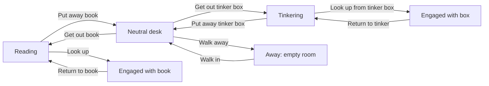

# Wilhelm: Lifelike Animation and Scene Continuity Plan

Status: Approved by the user in chat; baseline implementation completed for the available assets. New conversation/engagement footage, final editorial approval, and Pi installation validation remain outstanding. See [implementation and review instructions](wilhelm_playback.md).

Prepared: November 3, 2026

Target: Native Python application on Raspberry Pi 5.

This proposal replaces the timing and continuity recommendations in `wilhelm_integration_plan.md` for future implementation. The earlier document remains historical reference. Where they differ, use the user's edits and approved decisions in this document.

## 1. Intended experience

Wilhelm should appear to have his own interests, notice a visitor, turn his attention toward them, converse, and return to an activity. His movements must preserve the room, his posture, and the objects on the desk.

A slightly longer response is acceptable when the intervening movement is believable. Short response times must not be achieved by cutting actions short, accelerating footage, or fading between incompatible scenes.

Confirmed user preferences:

- Focus on the native Python / Raspberry Pi application.
- Acknowledge visitors at the next natural pause in an action.
- Prefer smooth, believable behavior over immediate speech.
- Expect the asset library to grow substantially.
- Speaking, listening, and thinking assets are being created; they are not available yet.
- Hardware is a Raspberry Pi 5. RAM capacity and display resolution are not yet known.

### Editable direction

- Personality and temperament: **[User: describe Wilhelm's manner, energy, and attitude toward visitors.]**
- Typical activity duration: **[User: preferred range, or approve measuring and tuning during review.]**
- Acceptable acknowledgment delay: **[User: preferred upper bound, if any. This is distinct from time until speech.]**
- Return after conversation: **[User: resume the previous activity, usually read, or another preference.]**
- Other experience requirements: **[User: edit here.]**

## 2. Scope and boundaries

Included:

- Asset catalog and compatibility review.
- Playback correctness, continuity, interruption policy, and speech coordination.
- Reading, tinkering, neutral desk, and book-present engagement.
- Extensible behavior scheduling and future conversation assets.
- Performance and acceptance checks on the actual Pi.

Deferred unless separately requested:

- Browser demo parity.
- Face recognition, reliable person tracking, or new Hailo inference.
- Continuous conversational interruption and acoustic echo cancellation.
- New model or voice selection.
- Close-up camera changes or empty-room sequences without connecting assets.

The current camera path detects motion. Planning must not assume it reliably identifies a person or knows their gaze direction.

## 3. Current asset inventory

Originals are in `Wilhelm_Generated/`. Never overwrite them. Generated playback assets belong under `assets/`.

The review used source inspection, media metadata, stills, extracted frames, and samples across original video playback. Exact edit points and seamless-loop approval remain editorial work; names and old image-difference claims are not sufficient evidence.

### Videos

All twelve originals are approximately ten seconds long, 1280 x 720, and 24 FPS. Windows media metadata reports stereo audio at 48 kHz. Audible content has not been approved; do not automatically enable those tracks.

| File | Intended scene change | Implementation notes |
| --- | --- | --- |
| `page_flip.mp4` | Reading -> reading | Occasional action. Includes head movement. Review the full action and loop seam before enabling repetition. |
| `tinker_box_study.mp4` | Tinkering -> tinkering | Activity variation with the box present. Verify prop and hand positions at both boundaries. |
| `get_out_book.mp4` | Neutral desk -> reading | Retrieves and opens the book. It is not a direct tinkering-to-reading bridge. |
| `get_out_tinker_box.mp4` | Neutral desk -> tinkering | Retrieves and places the box. |
| `put_away_book.mp4` | Reading -> neutral desk | Closes/removes the book and settles. Not currently included in the manifest. |
| `put_away_tinker.mp4` | Tinkering -> neutral desk | Closes/removes the box and settles. Not currently included in the manifest. |
| `look_up_from_book.mp4` | Reading -> engaged with book | Book remains present. Current crop ends before the full visitor-facing action settles. |
| `return_to_book.mp4` | Engaged with book -> reading | Current crop ends while he is still facing the visitor. |
| `look_up_from_tinker_box.mp4` | Tinkering -> engaged with box | Box remains present. Full visitor-facing transition. |
| `return_to_tinker.mp4` | Engaged with box -> tinkering | Box remains present. Return to studying tinker box. |
| `walk_away.mp4` | Neutral desk -> away (empty room) | Wilhelm stands up and leaves the room. |
| `walk_in.mp4` | Away (empty room) -> neutral desk | Wilhelm enters the room, walks to the desk, and sits down. |

These roles do not certify that every proposed boundary matches. Scene connections become available only after visual approval.

### Stills

| File | Dimensions | Role |
| --- | --- | --- |
| `A01_reading.png` | 2752 x 1536 | Reading reference and temporary resting fallback. |
| `end_conversation.png` | 947 x 534 | Visitor-facing reference with an open book. |
| `natural_state.jpeg` | 1376 x 768 | Neutral desk reference without the activity props; omitted from the current manifest. |
| `tinker_box.jpeg` | 1376 x 768 | Tinkering reference. |
| `attention_tinker_box.png` | 1280 x 720 | Visitor-facing reference with tinker box present; resting conversation fallback. |
| `empty_room.png` | 1280 x 720 | Empty room reference; held visual while Wilhelm is away. |
| `Break_reference.png` | 956 x 535 | Additional reading reference; not an automatic playback target. |
| `wilhelm_master_front.png` | 2752 x 1536 | Separate close-up composition requiring a deliberate connection. |
| `workshop_master_empty.png` | 2752 x 1536 | Separate empty-room composition requiring a deliberate connection. |

### Asset review worksheet

Complete this table during editorial review. Use source timestamps or source frame numbers, with the frame rate explicitly recorded. End-frame conventions must be consistent; use an exclusive end frame in processing.

| Clip | Approved in/out | Start pose / props | End pose / props | Safe acknowledgment points | Approved successors | Status / user notes |
| --- | --- | --- | --- | --- | --- | --- |
| page_flip | TBD | TBD | TBD | TBD | TBD | Unapproved |
| tinker_box_study | TBD | TBD | TBD | TBD | TBD | Unapproved |
| get_out_book | TBD | TBD | TBD | TBD | TBD | Unapproved |
| get_out_tinker_box | TBD | TBD | TBD | TBD | TBD | Unapproved |
| put_away_book | TBD | TBD | TBD | TBD | TBD | Unapproved |
| put_away_tinker | TBD | TBD | TBD | TBD | TBD | Unapproved |
| look_up_from_book | TBD | TBD | TBD | TBD | TBD | Unapproved |
| return_to_book | TBD | TBD | TBD | TBD | TBD | Unapproved |

## 4. Problems to address

Findings from the current repository snapshot:

1. The manifest crops look-up to frames 78..138 and return-to-book to 12..78. These ranges omit later movement visible in the originals.
2. Source-frame sequences inherit the renderer's 30 FPS instead of preserving 24 FPS. A 240-frame action consequently takes eight seconds instead of ten.
3. `main.py` begins greeting speech as soon as GREETING is entered. Visual readiness is not a prerequisite.
4. The transition rendering branch bypasses facial sprite animation, so speaking during a video cannot simply rely on the existing mouth renderer.
5. Debug actions use generic still endpoints, which can undo a prop change at the end of a clip.
6. `IdleActivityController.update()` is not called by the application loop. Completed activity changes are not coordinated with scene state.
7. Activity names such as `tinkering` are used to look up sprites, although the sprite key is `wilhelm_tinker`; the registered activity-to-sprite mapping must be respected.
8. The renderer calls `get_native_size()` and `unlock()`, but those methods are absent from the current player. These are static-review findings, not runtime test results.
9. Playback locks can be bypassed by the current restart behavior. A normal request needs a defined queue/interruption policy.
10. First-use frame loading and bulk scaling happen synchronously. Original and scaled frame caches can consume substantial memory.
11. Current tests cover pieces of playback but do not establish seamless visual continuity or full playback under real hardware load.

## 5. Proposed architecture

### Separate conversation state from physical scene state

Retain the conversation lifecycle for microphone, generation, and speech responsibilities. Add a physical scene model rather than expanding one enum into every possible combination.

The scene model should record:

- Activity: reading, tinkering, neutral desk, or future activities.
- Pose: approved named endpoint, including gaze and hand placement.
- Props: book absent/closed/open; box absent/closed/open, where relevant.
- Active clip and current source-time position.
- Pending intention: engage visitor, resume activity, or change activity.
- Last stable endpoint and approved recovery route.

"Engaged with book" and "neutral desk" are different physical scenes, even if both can eventually support conversation.

### Proposed scene graph

Do not enable an edge until the source endpoint, transition, and destination endpoint have been approved together.

### Scene director

Introduce one owner for action selection and playback requests. Proposed location: `renderer/scene_director.py`; final naming is an implementation choice.

Responsibilities:

- Accept intentions from the conversation controller and idle scheduler.
- Select a valid route from the actual current scene.
- Schedule transitions at approved checkpoints.
- Prevent normal events from restarting or replacing committed actions.
- Commit prop/activity changes when the appropriate endpoint is reached.
- Report visual readiness to the application.
- Preserve a coherent fallback if media or speech fails.

Keep all state commits and renderer-facing changes on the main thread. Background loaders and speech workers return tagged results through the existing event queue. Tag actions and conversations so stale completions cannot alter a newer scene or start obsolete speech.

### Proposed events and completion rules

| Event | Owner / effect |
| --- | --- |
| Engagement requested | Director records one pending intention and suppresses new autonomous actions. |
| Safe checkpoint reached | Director may select an approved route toward engagement. |
| Clip completed | Commit the validated destination scene once; retain its endpoint until the next media is ready. |
| Visual ready for greeting | Application may start prepared greeting audio for the matching conversation. |
| Greeting audio completed | Begin listening only when the scene is also ready. |
| Response prepared | Start at an approved speaking cue; animate against the audio playback clock. |
| Conversation ended | Finish audio, select an approved disengagement route, then resume an activity. |
| Asset preparation failed | Keep the current valid scene; disable the unavailable route and report diagnostics. |

Cooldown timing and physical disengagement are separate conditions. An elapsed cooldown must not reset the scene while an action is still completing.

## 6. Visitor interruption and speech policy

1. Confirm a trigger using existing debouncing; do not treat motion as identity.
2. Record the visitor request once. Repeated detections do not restart playback.
3. Prevent the idle scheduler from starting another action.
4. Continue the current action to its next approved checkpoint.
5. Follow the shortest *approved, believable* path toward engagement.
6. Start speech only after visual readiness, or at an explicitly reviewed cue during compatible footage.

An acknowledgment checkpoint is useful only if compatible acknowledgment footage or a matching pose exists there. A timestamp alone cannot make a mid-action cut natural.

Reading example: finish settling a page, look up, settle into the visitor-facing pose, greet.

Tinkering example: acknowledge with the box still present if suitable footage exists. Otherwise use an approved put-away-to-engagement route. Do not automatically retrieve a book just to reuse the reading greeting transition.

If no acceptable engagement route exists for an activity, leave that activity disabled in visitor-facing operation until the missing bridge is supplied. It can remain available in an asset preview mode.

Speech preparation can overlap animation. Audio playback must wait for the matching scene cue. The first milestone remains turn-based: microphone listening begins after the greeting. Capturing visitor speech during the approach would require a separate policy and validation against speaker feedback.

If the visitor leaves before greeting starts, finish the committed action and reassess the pending intention at a safe point. The present motion detector cannot prove departure; use a configurable grace policy and review it on site.

Editable policies:

- Presence-loss grace period: **[TBD after camera review.]**
- Maximum natural delay before acknowledgment: **[User preference / editorial limit.]**
- Manual wake during disengagement: **[Default proposal: queue engagement at the next approved checkpoint.]**
- Speech while turning toward visitor: **[Default proposal: disabled until specifically approved.]**

## 7. Asset manifest and processing changes

Extend `wilhelm_asset_manifest.json` into the source of truth. Proposed fields, subject to implementation review:

| Field | Purpose |
| --- | --- |
| Stable ID and source file | Identify the original without relying on display names. |
| Source fingerprint and metadata | Detect stale derivatives; preserve source FPS, dimensions, and duration. |
| Category | Transition, resting loop, activity action, or reference still. |
| Source in/out | Approved source range; retain anticipation and settling. |
| Entry / exit scene IDs | Define physical compatibility. |
| Checkpoints | Approved acknowledgment, interruption, and speech cues. |
| Loop range / seam approval | Describe what may repeat and whether it has been reviewed. |
| Face-motion ownership | Declare baked-in blinks/mouth movement and whether overlays are allowed. |
| Audio policy | Muted, separately approved effect, or other explicit treatment. |
| Fallback / required assets | Describe dependencies and disable incomplete routes. |
| Editorial status | Unreviewed, approved, rejected, or temporary prototype fallback. |

Processing requirements:

- Preserve originals and native motion speed.
- Use one framing/crop transform for stills, footage, and registered face layers.
- Record timing in derivative metadata; do not infer clip FPS from display FPS.
- Validate files, range boundaries, dependency availability, and compatible scene IDs.
- Regenerate stale derivatives deterministically; do not leave extra old frames in a shorter regenerated sequence.
- Publish only complete validated derivative sets so playback never loads a partially generated sequence.
- Produce contact sheets and a human-readable validation report.
- Treat failed processing as a failure, not a successful run with silent omissions.

Do not reuse the old claims that endpoint differences are only codec noise or that a particular crop is imperceptible without renewed visual review.

## 8. Visual continuity rules

- Review predecessor -> action -> successor together, at native speed.
- Preserve camera position, scene scale, lighting, face identity, hands, and props.
- Prefer direct joins between matching endpoints.
- Use dissolves only for small residual differences; tune duration per approved boundary.
- Do not dissolve between incompatible object arrangements or moving hand positions.
- Hold the actual final displayed frame until the next compatible asset is ready. A held frame is a temporary fallback, not a finished resting animation.
- Ensure completion does not briefly re-display an unblended frame after a dissolve.
- Do not reverse physical actions as a substitute for missing connecting footage.
- Keep the room fixed; avoid shifting the whole painting to simulate gaze or breathing.
- Never layer procedural blinks or mouth movement over footage unless that combination has been explicitly authored and approved.

Generative distortion within a source clip cannot be repaired by scheduling. Mark clips with changing hands, drifting furniture, or morphing objects for regeneration when the defect is visible at the intended display size.

## 9. Idle behavior and personality

Use separate scheduling for resting motion, occasional actions, and activity changes.

- Spend sustained periods reading or tinkering.
- Choose variations with repetition limits and contextual weights.
- Do not turn a page every time a short loop repeats.
- Retain activity history so resuming after conversation feels intentional.
- Schedule the next autonomous action only after the current action has completed.
- Pause autonomous scheduling whenever engagement is pending or conversation is active.
- Configure activity durations and action frequency independently.

Initial tuning proposals, not final requirements:

| Behavior | Starting proposal | User edits |
| --- | --- | --- |
| Activity dwell | Several minutes before considering a change | [Edit] |
| Major idle gesture | Tens of seconds between opportunities, varied by activity | [Edit] |
| Immediate repetition | Avoid repeating the same variation when alternatives exist | [Edit] |
| After conversation | Resume the previous activity through a valid route | [Edit] |

Current assets do not include approved quiet resting loops. Generate subtle reading, tinkering, and neutral-desk resting motion rather than filling every interval with an obvious action.

## 10. Contract for new conversation assets

Before generating a family of clips, approve a reference frame and scene ID. Keep framing, props, hands, costume, lighting, and identity consistent. Include short stable lead-in and settling sections so edit points can be chosen later.

Priority order:

1. Book-present visitor-facing listening/resting motion compatible with the look-up endpoint.
2. Speaking assets compatible with that scene and arbitrary generated audio.
3. Thinking and brief acknowledgment variations.
4. Tinkering-to-engagement and return bridges, preserving the box when appropriate.
5. Neutral-desk conversation variants.
6. Additional activities with explicit entry, exit, resting, and engagement routes.

Speaking requires an explicit technical choice:

- Registered mouth/eye layers over a stable approved composition; or
- A moving-face approach with tracking/compositing and audio-driven mouth motion; or
- Another reviewed method that supports arbitrary utterances.

A generic talking video does not automatically synchronize to generated speech. Do not paste fixed-coordinate mouth layers onto a moving head. Choose the speaking method before producing a large speaking asset set.

- Preferred speaking method: **[User / implementation review: decide after a small visual prototype.]**
- Conversation framing: **[Default proposal: retain the desk view.]**
- Temporary static conversation fallback acceptable for the first milestone: **[User: yes/no.]**

## 11. Raspberry Pi playback and memory plan

Discover RAM capacity, OS/display mode, and effective portrait viewport during implementation. The configured 1024 x 768 window does not establish the physical display resolution. Review how widescreen footage fits the final viewport before approving crops.

A 240-frame 1280 x 720 sequence uses approximately 844 MiB at four bytes per pixel before scaled copies and other application memory. Never base the design on loading an unlimited library of full-resolution frames.

Compare two bounded approaches on the Pi:

- Background video decoding into a bounded queue of ready frames.
- Selective predecoded frame caching at the approved display size.

Select based on measured frame pacing, memory, loading delay, and speech/camera contention. Predecoded frames may be suitable for short critical transitions; do not assume they are best for the entire library.

Requirements:

- Prepare the next likely asset before its handoff.
- Keep blocking file reads and bulk scaling out of the render loop.
- Bound decoded queues and caches in bytes, with eviction of inactive assets.
- Start the presentation clock after preparation, not before loading finishes.
- Preserve 24 FPS source timing independently from display refresh.
- Use monotonic timing and actual audio playback position for synchronization.
- Define underflow behavior: retain the latest valid frame, report the stall, and avoid skipping an essential prop-changing checkpoint.
- Keep pygame display/surface operations on the appropriate thread; workers may prepare data without mutating active display state.
- Do not claim zero CPU cost or Pi frame-rate guarantees without measurements.

## 12. Proposed implementation sequence

### Milestone 1: Correct one complete interaction

Files likely affected: `wilhelm_asset_manifest.json`, `tools/process_wilhelm_assets.py`, `renderer/animation.py`, `renderer/renderer.py`, `main.py`, `state_machine.py`, `portrait_config.json`, and a new scene-director module if adopted.

Work:

1. Approve reading, look-up, book-present engagement, and return boundaries.
2. Repair player/renderer method mismatches, FPS metadata, completion behavior, and request locking.
3. Introduce scene ownership and readiness events.
4. Gate greeting and listening against visual completion.
5. Use a matching still for conversation only if the temporary fallback is approved.
6. Keep the existing voice/generation route while fixing visual coordination.

Acceptance: reading -> acknowledgment -> greeting -> conversation fallback -> return to reading is coherent, without truncated movement or premature speech. This milestone validates orchestration; static conversation is not the final lifelike result.

### Milestone 2: Complete the autonomous activity cycle

Status: Completed. Reading, neutral desk, and tinkering activities are fully enabled with validated put-away, retrieval, engagement, and return footage.

Work:

1. Catalog/process both put-away clips and the neutral reference.
2. Approve each neutral/reading/tinkering boundary.
3. Connect the idle scheduler to the director.
4. Commit activity and prop changes on completion.
5. Add repetition limits and activity memory.

Acceptance: reading -> put away book -> neutral -> retrieve box -> tinker -> put away box -> neutral -> retrieve book works without prop popping. Approaching visitors are acknowledged from either reading or tinkering states.

### Milestone 3: Support arrivals throughout the enabled scene graph

Work:

1. Add approved checkpoints and missing engagement bridges.
2. Handle arrival during every action, repeated detections, and requests during disengagement.
3. Reject stale callbacks and make cancellations resolve at safe points.
4. Implement missing-media and speech-failure recovery.

Acceptance: one trigger produces one coherent acknowledgment; no action thrashing, incompatible cuts, or unnecessary detours.

### Milestone 4: Add conversation life

Work:

1. Prototype and approve the speaking method.
2. Integrate listening/resting, thinking, and speaking assets.
3. Coordinate expressions with speech boundaries and actual playback timing.
4. Add subtle variation without conflicting animation layers.

Acceptance: an ordinary multi-turn conversation maintains consistent scene geometry and believable attention, including pauses and silence.

### Milestone 5: Tune and document on the actual installation

Work:

1. Select the bounded playback/cache strategy using Pi measurements.
2. Approve final display framing and graphics options.
3. Tune personality timing with recorded sequences.
4. Document asset onboarding, resource limits, and recovery behavior.

Acceptance: sustained operation meets agreed visual, timing, and resource budgets under simultaneous camera and speech load.

## 13. Validation and definition of done

Automated checks should focus on behavior that can regress:

- Source timing remains correct at different renderer frame rates.
- Duplicate triggers do not restart committed actions.
- Scene/prop changes commit once at the intended endpoint.
- Greeting audio cannot start before the matching readiness event.
- Listening cannot start while greeting audio is playing.
- Stale action, loading, and speech completions are ignored.
- Missing assets disable invalid routes without losing the current valid scene.
- Playback underflow and cache eviction remain bounded and recover coherently.
- A complete rendered transition exercises actual player/renderer integration.

Manual review matrix:

| Scenario | Required observation |
| --- | --- |
| Cold startup | Coherent first scene; no partially loaded media. |
| Arrival while resting | Natural acknowledgment and correctly timed greeting. |
| Arrival during a page turn | Hands/page settle before the approved handoff. |
| Arrival while tinkering | Approved engagement route, with box continuity. |
| Arrival during prop retrieval/removal | Committed motion completes safely; no disappearing object. |
| Repeated motion triggers | One engagement intention; no restart loop. |
| Slow generation/synthesis | Compatible resting/thinking behavior while waiting. |
| Media or speech failure | Valid scene retained; clear diagnostics and coherent recovery. |
| Conversation ends | Audio finishes, disengagement completes, activity resumes. |
| Sustained operation | Stable memory, acceptable temperature, and consistent frame pacing. |

Record trigger-to-acknowledgment time, trigger-to-first-speech time, frame pacing/stalls, peak memory, CPU load, and temperature. Separate intentional animation time from preparation or processing stalls.

Suggested final soak test: at least 30 minutes with repeated arrivals and conversations on the actual display. Final duration and performance thresholds are agreed after the first hardware baseline.

Final completion requires approved asset boundaries, believable conversation animation, valid engagement routes for every enabled activity, and successful Pi validation. Automated tests alone cannot establish visual quality.

## 14. Decisions and review log

Fill these in before their dependent milestone. Unknown hardware details can be discovered during implementation; they do not require guessing now.

| Decision | Current proposal / status | User edits / approval |
| --- | --- | --- |
| Application target | Native Python / Pi confirmed | |
| Interruption policy | Next natural pause confirmed | |
| Personality | TBD | |
| Pi RAM | Discover on device | |
| Display resolution and framing | Discover and visually approve | |
| First conversation fallback | Matching still, temporary | |
| Speaking implementation | Small prototype before asset expansion | |
| Acknowledgment delay limit | TBD | |
| Return activity | Resume previous activity | |
| Original clip sound | Muted until reviewed | |
| Tinkering engagement bridge | Required before enabling visitor-facing tinkering | |
| Quiet resting loops | New assets needed | |
| Playback/cache strategy | Choose from Pi measurements | |

### User notes

<!-- Add corrections, asset instructions, examples of desired behavior, or revised priorities here. -->

-

### Approval record

- Approved scope / milestones: **Approved in chat: "The plan looks good and is approved. Let's implement it."**
- Requested revisions: **[User: fill in.]**
- Implementation authorization: **Granted in chat; proceed within the approved scope.**

This file remains editable. Plan approval authorizes implementation; unfinished asset connections still require footage and visual review.

### Implementation record

- [x] Version 2 scene/prop catalog covering all eight originals and the neutral reference.
- [x] Full source playback at native FPS, bounded decoder queues, prefetched next media, retained endpoints, and monotonic display pacing.
- [x] Scene director with route validation, committed actions, source-end checkpoints, activity memory, and guarded completion.
- [x] Greeting preparation/playback separation; speech and listening readiness gates; cooldown waits for physical completion.
- [x] Reading/page-turn behavior and preview of the complete prop-changing cycle.
- [x] Activity scheduler admits a future live activity only when engagement and return routes exist.
- [x] Atomic versioned review artifacts, original fingerprints, validation report, preview tool, and playback benchmark.
- [x] Automated regression checks and desktop native/demo/video validation.
- [ ] Final editorial approval of clip joins and shorter/intermediate checkpoints, if desired.
- [ ] Quiet resting loops and new speaking/listening/thinking assets.
- [ ] Tinkering/neutral engagement footage and live enablement.
- [ ] Actual Pi measurements, final framing approval, voice/camera load testing, and soak test.
