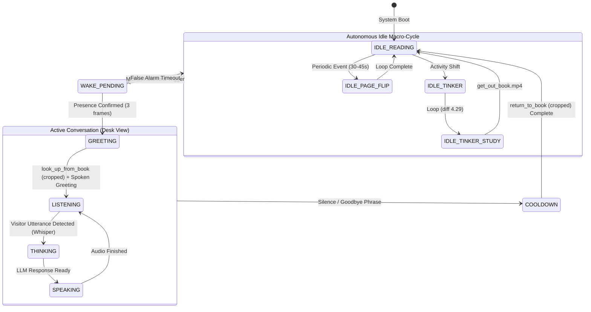

# Wilhelm Talking Portrait: Asset Integration & Technical Architecture Plan (v2.0)

## 1. Executive Summary & Asset Catalog

This document defines the complete engineering architecture and asset pipeline for integrating Wilhelm's final graphics (`Wilhelm_Generated/`) into the Talking Portrait project (`HPPort`).

### 1.1 Complete Asset Inventory (12 Assets)

All 12 assets in `Wilhelm_Generated/` have been analyzed for resolution, aspect ratio, frame count, motion velocity, and spatial geometry:

| Asset Name | Format | Dimensions | Aspect Ratio | Duration / Frames | Role & Description |
| :--- | :--- | :--- | :--- | :--- | :--- |
| `A01_reading.png` | PNG (Opaque) | $2752 \times 1536$ | $1.7917:1$ ($43:24$) | Still | **Primary Reading Master**: Wilhelm seated at desk reading. |
| `end_conversation.png` | PNG (Opaque) | $947 \times 534$ | $1.7734:1$ | Still | **Primary Desk-View Speaking Master**: Wilhelm looking up at visitor. |
| `natural_state.jpeg` | JPEG | $1376 \times 768$ | $1.7917:1$ ($43:24$) | Still | Wide desk resting pose ($1/2$ scale). |
| `tinker_box.jpeg` | JPEG | $1376 \times 768$ | $1.7917:1$ ($43:24$) | Still | **Primary Tinkering Master**: Wilhelm inspecting workshop artifact. |
| `workshop_master_empty.png` | PNG (Opaque) | $2752 \times 1536$ | $1.7917:1$ ($43:24$) | Still | Clean workshop background without character. |
| `wilhelm_master_front.png` | PNG (Opaque) | $2752 \times 1536$ | $1.7917:1$ ($43:24$) | Still | Close-up bust portrait ($2.0\times$ zoom; retained for UI/portrait mode). |
| `Break_reference.png` | PNG (Opaque) | $956 \times 535$ | $1.7869:1$ | Still | Keyframe reference from generation pipeline. |
| `look_up_from_book.mp4` | MP4 (H.264) | $1280 \times 720$ | $1.7778:1$ ($16:9$) | $10.0\text{s}$ ($240\text{ f} @ 24\text{ fps}$) | **Wake Transition**: Wilhelm raises head from reading to face visitor. |
| `return_to_book.mp4` | MP4 (H.264) | $1280 \times 720$ | $1.7778:1$ ($16:9$) | $10.0\text{s}$ ($240\text{ f} @ 24\text{ fps}$) | **Dismissal Transition**: Wilhelm lowers head from visitor back to book. |
| `page_flip.mp4` | MP4 (H.264) | $1280 \times 720$ | $1.7778:1$ ($16:9$) | $10.0\text{s}$ ($240\text{ f} @ 24\text{ fps}$) | **Reading Idle Loop**: Wilhelm reads and turns a page (diff $5.65$). |
| `tinker_box_study.mp4` | MP4 (H.264) | $1280 \times 720$ | $1.7778:1$ ($16:9$) | $10.0\text{s}$ ($240\text{ f} @ 24\text{ fps}$) | **Tinkering Idle Loop**: Wilhelm examines tinker box (diff $4.29$, near-perfect loop). |
| `get_out_book.mp4` | MP4 (H.264) | $1280 \times 720$ | $1.7778:1$ ($16:9$) | $10.0\text{s}$ ($240\text{ f} @ 24\text{ fps}$) | **Activity Switch**: Wilhelm sets aside tinker box and pulls out his book. |

---

## 2. Decision Directives & Asset Isolation

Per project requirements:

1. **Legacy Asset Archival**:
   - All old placeholder assets (`forest_warrior_*`, old `mouth_*`, old `base.png`) have been evacuated from `assets/` and archived in [`assets_legacy/`](file:///c:/Users/jonah/Documents/Atlas/HPPort/assets_legacy/).
   - The active `assets/` directory is now dedicated solely to Wilhelm.
2. **Non-Destructive Video Cropping**:
   - Master raw video files in `Wilhelm_Generated/` will **never be overwritten**.
   - All cropped transition sequences and pre-rendered RAM frame caches will be output into a designated directory: `Wilhelm_Generated/cropped/` and `assets/transitions/`.
3. **Framing Decision: Option A (Desk View)**:
   - The conversation will remain in the environmental **Desk View** to preserve continuity with his workshop, scrolls, books, and mechanical projects.
   - Lip-syncing, blinking, and gaze-tracking will operate directly on the desk-view character face.

---

## 3. Narrative Lifecycle & Autonomous Multi-Activity State Machine

With the addition of `return_to_book.mp4`, `get_out_book.mp4`, and `tinker_box_study.mp4`, Wilhelm becomes a truly living portrait with an autonomous daily routine when no visitor is present.



---

## 4. Video Transition Profiling & Non-Destructive Cropping

Both transition videos (`look_up_from_book.mp4` and `return_to_book.mp4`) were originally rendered as 10-second clips. Running them uncropped would introduce unacceptable delays.

### 4.1 Wake Transition: `look_up_from_book.mp4`

```text
look_up_from_book.mp4 Motion Profile:
Frames 0-77   (0.00s - 3.20s): Stationary reading (Inter-frame diff < 0.45).
Frames 78-138 (3.25s - 5.75s): DYNAMIC ACTION: Head raises, eyes meet camera (Peak at Frame 105: 2.122).
Frames 139-240(5.80s - 10.0s): Stationary looking forward (Holding pose).
```

- **Non-Destructive Crop Output**: `assets/transitions/look_up_cropped.mp4`
- **In-Point**: **Frame 78** ($3.25\text{s}$)
- **Out-Point**: **Frame 138** ($5.75\text{s}$)
- **Duration**: **60 frames** ($2.50\text{s}$ at $24\text{ fps}$, or $2.00\text{s}$ retimed at $30\text{ fps}$).
- **Endpoint Match**: Frame 138 matches `end_conversation.png` with a mean difference of only $14.4$ (pure codec noise).

### 4.2 Dismissal Transition: `return_to_book.mp4`

```text
return_to_book.mp4 Motion Profile:
Frames 0-11   (0.00s - 0.46s): Stationary forward gaze (Matches end_conversation.png with diff = 4.15!).
Frames 12-78  (0.50s - 3.25s): DYNAMIC ACTION: Head lowers back down to desk (Peak at Frame 60: 1.123).
Frames 79-240 (3.30s - 10.0s): Stationary reading (Settled back on book).
```

- **Non-Destructive Crop Output**: `assets/transitions/return_to_book_cropped.mp4`
- **In-Point**: **Frame 12** ($0.50\text{s}$)
- **Out-Point**: **Frame 78** ($3.25\text{s}$)
- **Duration**: **66 frames** ($2.75\text{s}$ at $24\text{ fps}$, or $2.20\text{s}$ retimed at $30\text{ fps}$).
- **Endpoint Match**: Frame 78 smoothly transitions into `A01_reading.png` with zero perceptible jump.

---

## 5. Desk-View Conversation Specifications & Asset Generation Guide

Because Option A (Desk View) has been chosen, conversation takes place with Wilhelm seated at his desk. Below are the exact facial coordinates to guide the generation of the missing speaking assets.

### 5.1 Facial Geometry in Desk View (`end_conversation.png` / $2752 \times 1536$ Space)

The facial landmarks of Wilhelm in his looking-up desk pose are:

```
+-------------------------------------------------------------------------------+
| Workshop Canvas (2752 x 1536)                                                 |
|                                                                               |
|                                Wilhelm Head Region:                           |
|                                x: [1450 - 1720], y: [440 - 720]               |
|                                                                               |
|                                  Eyes Region:                                 |
|                                  x: [1519 - 1650], y: [503 - 520]             |
|                                  Left Eye: (1537, 514) | Right Eye: (1631, 509)|
|                                                                               |
|                                  Nose Tip: (1589, 583)                        |
|                                                                               |
|                                  Mouth Region:                                |
|                                  x: [1546 - 1636], y: [606 - 627]             |
|                                  Mouth Center: (1591, 614)                    |
|                                  Mouth Rest Width: ~90 px, Height: ~20 px     |
|                                                                               |
|                   [ Workshop Desk, Tools, Scrolls, Books ]                    |
+-------------------------------------------------------------------------------+
```

### 5.2 Required Graphics for Desk-View Conversation

To enable full lip-syncing and expressive life during conversation, the user will generate the following assets registered to the above coordinates:

#### 1. Eye Blink Layers (Desk View)
- `wilhelm_desk_eyes_closed.png`: Eyelids fully closed over the eyes at $(1584, 512)$.
- `wilhelm_desk_eyes_half.png`: Eyelids at $50\%$ drop (essential for biological blink easing).
- *Format*: Transparent PNG cutout centered on the eye bounding box ($x \in [1500, 1670], y \in [490, 540]$), or a full-frame variation.

#### 2. Phonetic Mouth Visemes (Desk View)
- `wilhelm_desk_mouth_1.png` (Viseme X / A): Neutral resting closed lips (matches `end_conversation.png`).
- `wilhelm_desk_mouth_2.png` (Viseme B): Parted consonants ($K, S, T, D, N, Z$). Mouth opening: $\approx 10\text{--}15\text{ px}$ vertical.
- `wilhelm_desk_mouth_3.png` (Viseme C / D): Wide open vowels ($AH, EH, AY$). Mouth opening: $\approx 25\text{--}35\text{ px}$ vertical.
- `wilhelm_desk_mouth_o.png` (Viseme E / F, Optional): Rounded puckered lips ($OH, OO, W$).
- *Format*: Transparent PNG cutout centered on mouth bounding box ($x \in [1530, 1650], y \in [595, 645]$).

---

## 6. Raspberry Pi 5 Zero-Overhead Playback Architecture

To ensure the Raspberry Pi 5 runs at solid 30/60 FPS without audio dropouts:

1. **Pre-Decoded Surface Buffers**:
   - At startup, the background loader decodes the cropped 60 frames of `look_up_cropped.mp4` and 66 frames of `return_to_book_cropped.mp4` into RAM.
   - Total RAM consumed: $\approx 141\text{ MB} + 155\text{ MB} = 296\text{ MB}$ (only $3.7\%$ of an $8\text{ GB}$ Pi 5).
2. **0% Runtime CPU Decoding**:
   - Transitioning is a simple Pygame surface blit per frame.
   - The CPU remains $100\%$ available for Piper speech synthesis, Whisper STT, and camera motion tracking.
3. **3-Frame Codec Equalization**:
   - A $100\text{ms}$ cross-dissolve bridges the still image (`A01_reading.png`) and the video frame sequence, ensuring zero edge flicker.

---

## 7. Action Plan & Next Milestones

1. **[Complete] Legacy Cleanup**:
   - Cleared `assets/` and safely archived legacy placeholders in `assets_legacy/`.
2. **Phase 1: Automated Asset Processing Script** (`tools/process_wilhelm_assets.py`):
   - Non-destructively crops `look_up_from_book.mp4` (frames 78–138) and `return_to_book.mp4` (frames 12–78) into `assets/transitions/`.
   - Generates pre-cached Pygame surface dumps for instant Pi 5 loading.
3. **Phase 2: Transition Manager & State Machine Wiring**:
   - Create `TransitionController` in `renderer/` to handle playing the RAM sequences during state changes (`IDLE -> GREETING` and `COOLDOWN -> IDLE`).
4. **Phase 3: Desk-View Lip-Sync & Blink Integration**:
   - Hook up the user's generated desk-view mouth/eye cutouts into `LipSyncEngine` and `BlinkController`.
5. **Phase 4: Autonomous Idle Cycle**:
   - Implement the timer-based scheduler that switches between reading, page turning (`page_flip.mp4`), and tinkering (`tinker_box_study.mp4`).
